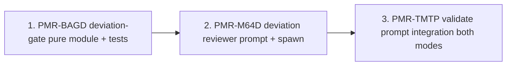

# Plan: Spec-deviation check in pi-flow validate (PMR-R9EN)

Date: 2026-11-04
Mode: personal
Research: `notes/research/2026-11-04-looking-into-adding-to-pi-flow.md`

## Intent

Extend the validate step with a spec-deviation check that runs as a separate
pass after the code review. It compares the delivered diff against the spec
(plan.md via plan-path metadata, else ticket description; spec file + Jira
text in work mode) and reports when the code deviated and why. The "why" is
inferred from commit messages and aven notes and is always labelled
`inferred`. Report-only: the human decides accept vs back to /implement.
`flow_land`, `landDecision`, and the bash interceptor are untouched.

## Execution order

Dependency links encoded: M64D depends on BAGD, TMTP depends on M64D.
Rationale: the contract module owns the constants both the emitter (2) and
the integration parser (3) consume; the spawn wiring (2) must exist before
the validate prompt can invoke it (3).

## 1. PMR-BAGD — Deviation-gate pure module and parser tests

New `packages/pi-flow/validate/deviation-gate.ts`, mirroring `review-gate.ts`
in shape. Owns the deviation verdict contract: `DEVIATION_VERDICT_HEADING`
("## Deviation Verdict"), count/line regexes, `DEVIATION_CONTRACT_PROMPT`,
plus `parseDeviationArtifact` (strict, fail-closed: missing/duplicate/
negative count is an explicit error, never silent 0; scoped to the LAST
deviation-verdict heading so quoted contract text cannot false-positive) and
`decideDeviationRoute` (pure: 0 -> proceed; >0 -> human decision, accept or
/implement). Deviation lines carry what / why (labelled inferred, with
evidence) / file:line.

Acceptance criteria:
- Both functions pure, no I/O.
- Test matrix: missing count, duplicate counts, negative/non-integer,
  quoted fenced contract vs real heading verdict, deviation lines with
  why+evidence.
- `bun run test` passes.

## 2. PMR-M64D — Deviation reviewer prompt and spawn wiring

Fresh-context deviation subagent via the existing `launchSubagent` path in
`packages/pi-flow/review/review.ts` — no new spawn infrastructure. Prompt
takes resolved spec text, git diff vs base, and mined why-inputs (commit
messages, aven notes: interview, worktree, oneshot outcome, escalation).
Emits the verdict artifact from the shared contract constants so parser and
emitter cannot drift. Inputs bounded (spec section + diff, not whole
history). Thin spec degrades to "insufficient spec to compare" instead of
inventing deviations. Rationale always labelled inferred with evidence.

Acceptance criteria:
- Spawns via existing launchSubagent path.
- Prompt emits exactly one deviations_count line under the verdict heading.
- Prompt-composition tests: spec present/absent, mode variants.
- `bun run test` passes.

## 3. PMR-TMTP — Validate prompt integration in both modes

Add a deviation gate section to `packages/pi-flow/validate/prompt.ts`
(alongside `buildReviewGateSection`), run after a 0-blocker review, before
`flow_phase_complete(phase="validate")`, in both personal and work mode.

Spec-source resolution: personal planned -> plan.md via plan-path metadata
(`aven show --full` heredoc parsing; reuse `aven/client.ts` / `aven-spec.ts`
patterns — never exec aven in new code, never trust `show --json` metadata
on aven 0.1.39); personal oneshot -> ticket description; work -> spec file
via `resolve_spec_path` + Jira text via acli. After the check: strict parse;
0 deviations -> record "no deviation" aven note, proceed; >0 -> present
report via ask_user_question (accept / fix); decision recorded as an aven
note either way; accept proceeds, fix routes to /implement with the report.

Report-only: `flow_land`, `land-gate.ts`, and the bash interceptor unchanged.

Acceptance criteria:
- Deviation section in both validate prompt branches.
- Missing/malformed artifact fails closed (re-run instruction).
- Tests: prompt composition for all spec-source variants and both modes.
- Diff verifies flow_land / land-gate.ts / index.ts interceptor unchanged.
- `bun run test` passes.

## Verification (whole epic)

- `bun run test` green in packages/pi-flow.
- Manual dry-run of /validate on a small personal feature: deviation report
  appears after the review; accept path lands; fix path routes to /implement.
