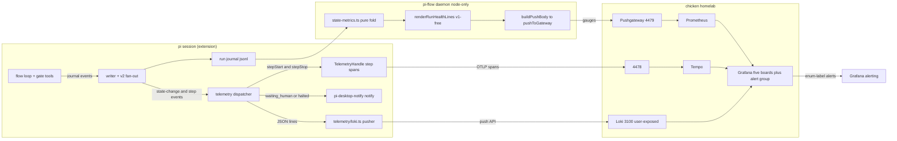

# pi-flow observability — how it works (LLM handoff / context doc)

Feed this file to an LLM before working on pi-flow telemetry or the Grafana board. It states what exists,
where it lives, how data flows, and the traps already hit. Last verified against the code on 2026-11-25
(PMR-ZV9Y, the v2 state-machine rework). For the chronological incident log see
[`pi-flow-observability-troubleshooting.md`](pi-flow-observability-troubleshooting.md).

> **v2 cutover (PMR-ZV9Y, 2026-11-25).** A run's state is now described by **one** vocabulary — `state`, `phase`,
> registered `step`, closed `reason`, `wait_kind` — emitted from the run journal and rendered to Prometheus, Loki
> and Tempo. The old v1 state-vocabulary metric lines (`pi_flow_run_status`, `pi_flow_run_halt_reason`,
> `pi_flow_human_wait_seconds`, `pi_flow_gate_wait_seconds`) are **retired**: every board and alert rule now reads
> the v2 series. If you are picking up a pre-cutover bug report that quotes one of those names, it describes a
> series that no longer renders — see §10. Cost, tool-call, duration, gate-decision, retry, worktree-sweep and the
> whole `pi_flow_adhoc_*` family are **unchanged** and still described here as before.

## 1. What this is

pi-flow (`packages/pi-flow`) drives the PIV flow (plan → implement → validate → feedback) for an aven ticket. The
**run journal** (`~/.pi/agent/pi-flow/runs/<ref>.journal.jsonl`, projected by `run-state.ts`) is the single source of
truth, and it has **three renderers** (the one design problem PMR-ZV9Y solved — see §3):

| Renderer | Signal | Produced by | Goes to | Answers |
| --- | --- | --- | --- | --- |
| **Prometheus** | `pi_flow_*` gauges + counters (Pushgateway text) | the daemon-reachable pure fold `flow/state-metrics.ts` called from `flow/run-health.ts` → `buildPushBody` → `flow/push.ts` | Caddy `:4479` → Pushgateway → Prometheus | current state, phase, step, waits, retries, cost |
| **Loki** | transition-event log lines | the live-session writer fan-out `telemetry/dispatch.ts` → `telemetry/loki.ts` (config-gated) | `<telemetry.loki.endpoint>/loki/api/v1/push` → Loki | per-run state timeline (what happened, when, why) |
| **Tempo** | OTLP/HTTP JSON spans (phases + **step spans** since PMR-ZV9Y 4.1) | `telemetry/` (live, every pi process) | Caddy `:4478` → Tempo | trace tree: phase → step → tool/gen |

A **desktop notification** (via `@gtheys/pi-desktop-notify`) hangs off the same Loki fan-out and fires on
`waiting_human` / `halted` only (§7). Grafana alerting is the independent second channel (§6).

**Prometheus is the after-the-fact rollup, re-rendered live.** Metrics are derived from the journal, not measured in
the moment: the terminal autopush (`onRunEnd` → `createCostAutoPush`, env-gated by `PI_FLOW_PUSHGATEWAY_URL`,
idempotent, ~1.5 s settle so the journal's async appends land first) and the daemon's liveness pass (§5) both render
the **same** body through `buildPushBody`, so both push paths carry the identical v2 gauges. `/flow-cost <ref> --push`
remains the manual retry/backfill. Failure = a warning with that command.

**Cost sources in the rollup** (`flow/cost.ts`, unchanged): (a) spawned WORKER sessions (review, deviation check,
implementers…), attributed via the spawn notes in the run journal; (b) the MAIN pi session, attributed to
plan/implement/validate by splitting its entries across the journal's phase windows (`phaseWindows`, `buildMainRows`).
(b) needs the journal's `main-session` event (written by the loop at every phase start, `getSessionFile` dep wired in
`index.ts`) — so **runs started before 2026-11-07 evening have no main-session cost** (only workers, i.e. validate)
and cannot be backfilled; new runs are pushed automatically; `/flow-cost <ref> --push` re-exports. Main rows are
pushed as `agent="main"`. Unreadable session file = one coverage-gap row, never a zero. Windows: a phase runs from its
phase-start to the next phase-start; the last one ends at its phase-complete; entries outside every window (chat
before/after the flow) are ignored.

**Owner identity — `owner-session` (PMR-T9ZQ, 2026-11-22).** Same shape as `main-session` (main pi session file + ref +
timestamp) plus the writing process's `pid`, but it is a **projected** event, not journal-only: `applyEvent` folds it
last-wins into `state.owner` (`{sessionFile, pid, at}`) and deliberately does **not** bump `updatedAt` — an owner
refresh is a liveness stamp, not run activity, and must not make a parked run look freshly updated to the sweep or the
widget. Write sites: `/flow <ref>` start (right after `run-start`, `index.ts`) and a refresh on **every** phase prompt
(`sendPhasePrompt`, `flow/loop.ts`, next to the `main-session` write). `sessionFile` is nullable — a headless or
server-driven run has no session file — so `pid` is the liveness carrier; the resume picker probes it with
`process.kill(pid, 0)` (display hint only, never a gate). Consumers that read the journal tail must go through
`readRunEvents` + `projectRunState` (the picker path), because journal-only kinds never reach the projection. A failed
write stays best-effort: `writer.record` reports `false`, it never throws, never halts a phase.

## 2. Infrastructure (chicken homelab, podman quadlets)

Source of truth: `~/Code/personal/homelab/quadlets/*` (git repo). Deployed copy: `/opt/homelab` (root-owned; needs
`sudo cp` + `systemctl restart <svc>`). Everything is reached over tailscale: `https://chicken.tail4250d0.ts.net:<port>`.

| Component | Where | Notes |
| --- | --- | --- |
| Caddy | `quadlets/caddy/Caddyfile`, `caddy.container` | TLS + authelia forward-auth. **Client ports are the host ports `44xx`; the `84xx` ports are container-internal and unreachable** (publishing is `PublishPort=100.108.226.64:44xx:84xx`). |
| `:4478` | Caddy → `tempo:4318` | OTLP/HTTP ingest, bearer auth (`PI_FLOW_OTLP_TOKEN`). No authelia. |
| `:4479` | Caddy → `pushgateway:9091` | metrics push, bearer auth (`PI_FLOW_PUSHGATEWAY_TOKEN`). |
| `:4443` | Caddy → Grafana (`/grafana/`), Prometheus (`/prometheus/`), authelia… | humans, authelia SSO. |
| Tempo | `quadlets/tempo/tempo.yaml`, image `grafana/tempo:2.10.10` | OTLP grpc 4317 + http 4318, local storage, 14d retention (`block_retention: 336h`), `MemoryMax=1G`. No published port (Grafana reads `http://tempo:3200` on `homelab.network`). **`ingester.trace_idle_period: 3m`** (see §8). |
| Pushgateway → Prometheus | `quadlets/pushgateway`, `quadlets/prometheus/prometheus.yml` | scrape job `pushgateway`, `honor_labels: true` so pushed `ref/phase/agent` labels survive; series carry `job="pi-flow"`. |
| Loki | user-exposed on chicken, base URL `http://100.108.226.64:3100` | push receiver only (`/loki/api/v1/push`); Grafana reads it over `homelab.network` via the `loki` datasource. **Exposure is user-owned (PMR-ZV9Y D2) — pi-flow ships the pusher config-gated, disabled by default, fail-silent.** Verified answering `204` to pushes and queryable as `{job="pi-flow"}` on 2026-11-25 even while `/ready` returned `503`. |
| Grafana | `quadlets/grafana`, datasources provisioned in `provisioning/datasources/` | Prometheus uid **`PBFA97CFB590B2093`** (must not change), Tempo uid **`tempo`**, Loki uid **`loki`**. |
| grafana-image-renderer | `quadlets/grafana-image-renderer` | enables `gcx dashboards snapshot` PNGs. Needs Grafana `GF_RENDERING_CALLBACK_URL=http://grafana:3000/grafana/` (else renders return the login page). |

The k8s `tempo` in the `salaryhero-local` minikube namespace is an unrelated SalaryHero app Tempo (gRPC only). Ignore it.

## 3. The v2 vocabulary (the contract every consumer reads)

One identity, **one closed enum per dimension**. Nothing below is free text in a label — free text (halt-note prose,
deviation reasons, the step name beyond the registry) rides the **journal line**, the **Loki JSON line**, and the
**Tempo span attribute**, never a Prometheus/Loki label value. This is the ISC-A-1 cardinality rule, enforced at the
single source `flow/vocabulary.ts` (zero-import, pure) and mirrored in the Grafana value mappings.

| Dimension | Values | Source |
| --- | --- | --- |
| `state` | `running \| waiting_human \| waiting_machine \| halted \| done \| stale` | `flow/vocabulary.ts FlowState` |
| `phase` | `plan \| implement \| validate \| feedback` | unchanged `FlowPhase` (loop / `PHASE_LABEL` world) |
| `step` | registered names only (§4): `plan.spec-approval`, `validate.code-review`, `validate.deviation`, `validate.spec-diff`, `validate.aven-notes` | `flow/steps.ts STEP_REGISTRY` |
| `reason` (closed enum, 10) | `spec_approval_pending \| code_review_pending \| escalation \| retry_budget_exhausted \| blocker_budget_exhausted \| label_miss \| deviation_gate_rerun \| subagent_in_flight \| prompt_send_failed \| aven_read_failed` | `flow/vocabulary.ts FlowReason` |
| `wait_kind` | `human \| machine` — derived from the reason | `reasonWaitKind()` (`spec_approval_pending`, `code_review_pending`, `escalation` → human; all others → machine) |
| `gate` | `spec-review \| code-review \| deviation \| answer` | existing gate-answer labels, unchanged |

`LoopRunStatus` (`running | paused | halted | done`) is **NOT** renamed or overwritten — v2 state is **derived** from
the journal's `state-change` events with a legacy fallback (§4), because resume (`flow/resume.ts`), the phase-3 pending
protocol and old journals depend on `LoopRunStatus` (ISC-A-2).

**Expected action map** — one source, `expectedAction()` in `flow/vocabulary.ts`, used by the desktop-notify body and
mirrored as value mappings on the Waiting-on-me board. `{ref}` is a literal placeholder substituted at call time (and,
in the board, NOT — see §6 gotcha):

| reason | expected action |
| --- | --- |
| `spec_approval_pending` | `/flow answer {ref} approve` |
| `code_review_pending` | `/flow answer {ref} pass\|fail` |
| `escalation` | `intervene: /flow {ref} (or fix forward)` |
| everything else | `—` |

**Journal v2 event kinds (in `run-state.ts`):**

- `state-change` — `{kind, at, ref, state, reason?}` — **projected** last-wins into `FlowRunState.currentState`.
  `recordRunEvent` appends it to the journal **even when the projection ignores it** (an out-of-vocabulary `state`/
  `reason` is dropped from the fold but never from the journal) — the PMR-C998 drop-bug fix that makes a drifted enum
  harmless evidence rather than a lost line.
- `step-start` / `step-stop` — `{kind, at, ref, phase, step}` — **journal-only** (`isJournalOnlyEvent` true), like
  `main-session`/`spawn-record`/`step-output`: boundary evidence, never modelled in the projection.

## 4. The three-renderer architecture + data flow

The "one projector" must reconcile three consumers with incompatible shapes: Prometheus needs a **pure journal fold**
that renders inside the daemon-reachable `buildPushBody` (liveness re-pushes it); Loki needs **live event pushes**
from the session (the daemon never appends journal events and must not push history); Tempo step spans need the live
session's trace context (`traceId`), which a journal fold cannot reconstruct. So the journal stays the single source of
truth with three renderers reaching it through different seams.



**Renderer 1 — Prometheus (pure fold).** `flow/state-metrics.ts` (node-only, daemon-reachable) derives the six v2
gauges from the journal; `flow/run-health.ts::renderRunHealthLines` appends them after the kept frozen block. Both
push paths — the terminal autopush and the daemon liveness pass — call the identical `buildPushBody` →
`renderRunHealthLines` chain (the PMR-8MQH invariant), so a running flow and a finished flow carry the same series
shapes.

**Renderer 2 — Loki + desktop notify (session-side writer fan-out).** `telemetry/dispatch.ts::createEventFanoutWriter`
wraps the session's `EventWriter` at its **single** construction site in `index.ts`. Each `record` writes the journal
first (original best-effort semantics preserved), then routes by kind: `state-change` → Loki pusher **and** the
desktop-notify sink; `step-start`/`step-stop` → Loki pusher **and** `TelemetryHandle.stepStart`/`stepStop`. Every emit
site (loop, code-review, deviation, run-attempt) already journals through that writer seam, so one wrap covers all of
them. **The daemon is never wrapped** — it has no live event stream and pushes no Loki.

**Renderer 3 — Tempo step spans (`TelemetryHandle.stepStart`/`stepStop`).** Uses the live trace context only the
session has. See §8.

### Emission seam map (where v2 events are journaled, and why ONE wrap covers them)

| Site | Emits | Seam |
| --- | --- | --- |
| `flow/loop.ts` guarded `emitStateChange` (snapshot choke point, subagent-in-flight branch, every halt site, done, spec-approval pause) | `state-change`, plus `step-start`/`step-stop` for `plan.spec-approval` | `deps.journal`/`deps.journalV2` → `index.ts` `journalSerial` → `writer.record` (wrapped) |
| `tools/code-review.ts` open/close review gate (`openReviewSteps` idempotent pairing) | ask → `state-change{waiting_human, code_review_pending}` + `step-start{validate.code-review}`; answer (pass OR fail) → `step-stop` + `state-change{running}` | tool's mode-aware `writer.record` (wrapped) |
| `tools/run-attempt.ts` escalation outcome | `state-change{waiting_human, escalation}` (escalate only) | `deps.journalV2` → writer (wrapped) |
| `tools/deviation.ts` `journalGateEvent` | pin → `step-start{validate.deviation}`, verdict → `step-stop`, rerun → `state-change{waiting_machine, deviation_gate_rerun}` | `journalGateEvent(event, writer)` → `writer.record` (wrapped) |

Two **audited, deliberately unrouted** fallbacks: `run-attempt.ts`'s direct `recordRunEvent` attempt-ledger fallback
writes `attempt-record` (not a v2 kind), and `flow-submit.ts`'s fallback writes `step-output` (not a v2 kind); both
always receive the wrapped writer in production, so no v2 event is lost. Pinned by `test/telemetry-dispatch.test.ts`.

**Subagent-in-flight wait** (loop.ts) is now visible as `state-change{waiting_machine, subagent_in_flight}` — the
branch has no `snapshot()` call, so the loop emits it explicitly (it was invisible in v1). The next settle emits the
return to `running`.

### The v2 Prometheus gauges

The six gauge families `flow/state-metrics.ts::renderStateMetricLines` appends (the plan's table, in this order). No
`mode` label in any series — the Pushgateway group URL `/mode/work` already carries it (v1 convention). All label
values come from the closed enums above.

| Metric | Labels | Value | Answers |
| --- | --- | --- | --- |
| `pi_flow_state` | `ref, state, reason` | 1 | current state (`reason=""` when N/A) |
| `pi_flow_state_start_seconds` | `ref, state, reason` | epoch seconds | when the current state began — alerts compute `time() - …` so a wait ages **without needing pushes** (liveness gates on `running`; a `waiting_human` ref gets no re-push, so a duration gauge would freeze) |
| `pi_flow_phase` | `ref, phase` | 1 | current phase |
| `pi_flow_wait_seconds` | `ref, wait_kind, reason` | cumulative seconds | total wait per kind/reason across the run |
| `pi_flow_step` | `ref, phase, step` | 1 | in-flight **registered** step (last `step-start` without a stop) — only names in `flow/steps.ts::STEP_REGISTRY` reach this label (fix-round-3, deviation #3) |
| `pi_flow_step_seconds` | `ref, phase, step` | cumulative seconds | completed **registered** step durations — same registry closure; the journal + Loki line still carry free-form names |

**Legacy fallback (ISC-6).** A journal with no `state-change` events derives v2 state from the projected loop status —
`paused` → `waiting_human` (reason `""`), `halted` → `halted` (reason `""`), `running` → `running`, `done` → `done`;
wait windows fall back to the (retired-v1) paused-window scan re-implemented in `state-metrics.ts` (wait_kind `human`,
reason `""`). Old runs still render, just without reason granularity.

**THE TYPE-LINE RULE (PMR-WBC2 class).** `renderStateMetricLines` emits **bare sample lines, never `# TYPE` /
`# HELP`** — that looks wrong but is load-bearing. The gateway auto-detects and stores every pi-flow family as
**untyped** (the `# TYPE … untyped` strings in `test/push.test.ts` / `test/reconcile.test.ts` fixtures are copied from
a LIVE dump). A tombstone re-POST strips every `#` line (`filterGroupLines` in `flow/push.ts`), so a **typed** first
push followed by an **untyped** re-POST is the whole-group `400` ("… is not a GAUGE") that once made every tombstone
fail. Emitting `# TYPE pi_flow_state gauge` would flip that family to gauge and break reconcile for every ref carrying
v2 lines. Bare lines are the repo convention, not an omission — see the module header of `flow/state-metrics.ts` and
`flow/push.ts`.

### Final frozen push-body order

`buildPushBody` (cost family) → then `renderRunHealthLines` in this fixed order:

1. **kept frozen block** — `pi_flow_gate_decisions_total`, `pi_flow_retry_attempts`, `pi_flow_blocker_retries`,
   `pi_flow_worktree_sweep_total`, `pi_flow_run_start_seconds` (gate decisions, the attempt/blocker counters and the
   worktree-sweep counts are evidence/counters, **not** state vocabulary — they stay; the retry/worktree alerts keep
   their queries).
2. **v2 state gauges** — `pi_flow_state`, `pi_flow_state_start_seconds`, `pi_flow_phase`, `pi_flow_wait_seconds`,
   `pi_flow_step`, `pi_flow_step_seconds`.

**Retired (PMR-ZV9Y 7.1), rendered nowhere:** `pi_flow_run_status`, `pi_flow_run_halt_reason`,
`pi_flow_human_wait_seconds`, `pi_flow_gate_wait_seconds`.

**Tombstone (reconcile).** `tombstoneBody` (`flow/reconcile.ts`) does the v2 label-VALUE surgery on the **state
lines** — `pi_flow_state` / `pi_flow_state_start_seconds` with
`state="halted"|"waiting_human"|"waiting_machine"` become `state="stale"` — **and drops the transient
`pi_flow_step{…}` open-step gauge** from the re-POSTed body (P3a). `pi_flow_step` is the only v2 family with no
`state` label whose meaning ("a step is in flight right now") is definitively false for a retired run, so it cannot
be value-flipped — dropping is the only lever; it fires only when a state line was flipped and never touches
`pi_flow_step_seconds`. The **primary** anti-phantom lever is render-side suppression (`state-metrics.ts`
`isTerminalState` emits no open-step line for a halted/done/stale run); the tombstone drop is the belt-and-braces
half that also cleans an already-stored phantom on a replace-semantic gateway (a harmless no-op on the
merge-on-write homelab gateway, PMR-WBC2). Every other family (`pi_flow_phase`, `pi_flow_wait_seconds`,
`pi_flow_step_seconds`, the counters, cost rows) is re-emitted byte-identical. Candidacy stays journal-keyed (the
projected loop status), so retiring the v1 status series did not change which refs are stale — only which lines in a
fetched body are rewritten. A stored group that predates the v2 render carries only v1 lines, so the tombstone reads
it as "already clean" and never re-posts it — harmless because every consumer was cut to v2 (§10). §5 keeps the
liveness detail.

## 5. Step registry, prompts, and the emission guard

`flow/steps.ts::STEP_REGISTRY` is the closed map of named step boundaries (a const map, pure, daemon-reachable):

| Phase | Registered steps |
| --- | --- |
| `plan` | `plan.spec-approval` |
| `implement` | *(empty — free-form step names only, advisory)* |
| `validate` | `validate.code-review`, `validate.deviation`, `validate.spec-diff`, `validate.aven-notes` |
| `feedback` | *(empty — free-form)* |

`validate.spec-diff` and `validate.aven-notes` are **documented names without machine-emitted start/stop** — no tool
boundary exists for them (they are prose steps in `validate/prompt.ts`), so `flow_submit` evidence is all they get.

**Prompt letters are bound 1:1 to registry names via AIDEV anchors** (the D1–D3/H1 + approval-wait mapping; grep
`PMR-ZV9Y 1.2 step registry` in `validate/prompt.ts` and `plan/prompt.ts`):

| Anchor | Registry name | Where |
| --- | --- | --- |
| approval wait | `plan.spec-approval` | `plan/prompt.ts` `APPROVAL_SUFFIX` (loop pause → step-start; the restart after `/flow answer` — approve **or** reject — journals step-stop in `loop.ts::start()` **before** the `state-change{running}` snapshot, fix-round-3 deviation #1) |
| D1 | `validate.spec-diff` | `validate/prompt.ts` deviation gate |
| D2 | `validate.aven-notes` | `validate/prompt.ts` deviation gate |
| D3 | `validate.deviation` | `validate/prompt.ts` deviation gate (the `deviation_review` tool boundary) |
| H1 | `validate.code-review` | `validate/prompt.ts` `buildPersonalCodeReviewGate` (the `code_review` tool boundary) |

`flow_submit` (in `flow/step-output.ts`) gives an **advisory hint** on an unregistered step name (it lists the
registered names) and **never rejects** — advisory posture throughout, a warned submission never gates a phase.

**Render-boundary registry closure (ISC-A-1, fix-round-3 deviation #3).** The `step` label value on `pi_flow_step` /
`pi_flow_step_seconds` is registry-CLOSED at the Prometheus render boundary, not merely charset-filtered:
`flow/state-metrics.ts::scanStepWindows` value-imports `isRegisteredStep` from `flow/steps.ts` and drops any
`(phase, step)` the registry does not list, so `implement`/`feedback` (empty registries) contribute no step-gauge
lines. The journal and the Loki JSON line still carry free-form step names — only the label surface is closed
(bounded cardinality). `flow/steps.ts` is pure data (its lone `./orchestrate.ts` edge is type-only, erased at runtime),
so it stays daemon-reachable and is registered as its own root in the `cost-rows-node-only` closure guard.

**Emission guard (loop).** A private `emitStateChange` keeps the last-emitted v2 state on the loop instance (seeded on
`start()`/resume from the journal tail — last `state-change`, else the phase-1 fold), and skips when the new state
equals it. So the repeated `snapshot('running')` at every phase prompt never spams `running→running`, and a restarted
run does not re-emit the seeded state. Every journal emit and fan-out call is best-effort, inside try/catch — a
journaling failure never halts a phase (loop never-throw, ISC-A-5).

## 6. Loki transition events (push config + gotchas)

`telemetry/loki.ts` is a minimal hand-rolled JSON POST mirroring `telemetry/exporter.ts` (no collector dependency, no
growing buffers, no retry queue).

```bash
curl -s -X POST http://100.108.226.64:3100/loki/api/v1/push \
  -H 'content-type: application/json' \
  -d '{"streams":[{"stream":{"job":"pi-flow","flow_ref":"PROBE-X","state":"waiting_human"},"values":[["1732000000000000000","{\"kind\":\"state-change\"}"]]}]}'
```

Body shape: `{"streams":[{"stream":{...labels},"values":[[<ns>, line]]}]}`.

- **Config:** `telemetry.loki = { enabled?: false, endpoint?: string, headers?: Record<string,string> }`. The pusher
  appends `/loki/api/v1/push` to `endpoint` (which stores the **base** URL only). `enabled` defaults to **false** — a
  fresh install makes zero Loki calls. User docs: `packages/pi-flow/README.md` ("Loki transition events").
- **Closed label set only:** `job="pi-flow"` + identity (`flow_ref`, `mode`) + the v2 enums (`phase`, `state`,
  `reason`, `wait_kind`, `kind`). `buildLokiStream`/`buildEventLokiLabels` is a fixed builder so a caller structurally
  cannot inject an arbitrary label, and it drops empty/absent values (a reasonless state never emits `reason=""`).
  The step name and all free text live in the **JSON line**, never a label (ISC-A-1).
- **Session-side only.** The live-session fan-out pushes each event as it is recorded; the daemon never pushes Loki
  (single strict config reader in `config.ts`, no tolerant daemon mirror — unlike `reconcile`/`liveness`).
- **Fail-silent.** Fire-and-forget with `AbortSignal.timeout(2500)`; an unreachable/unconfigured endpoint writes **at
  most ONE** journal note per process then stays silent; never a rejected promise into the host. Runs proceed
  identically with no Loki backend at all.
- **ns timestamps via string append, never float multiply.** Loki's push API wants nanosecond timestamps; building the
  ns value by multiplying a float seconds value loses precision (and can land a non-integer in `values`); the pusher
  appends to an integer-ms string instead.
- **`/ready` 503 ≠ broken.** The endpoint answered `204` to four pushes and the streams were queryable as
  `{job="pi-flow"}` on 2026-11-25 even while its `/ready` returned `503` — do not gate a live check on `/ready`.

## 7. Desktop notifications (pi-desktop-notify)

The notify sink shares the fan-out handler bag and is guarded **separately** from the Loki push, so neither failure
costs the other.

- **Gate:** `notify.desktop.enabled` (default **true** — an opt-OUT channel, the opposite posture of `telemetry.loki`).
  Only two v2 states page: `waiting_human` and `halted`. `waiting_machine` (a retry budget, a subagent still in
  flight, a deviation gate re-run) is a Grafana/Loki concern, never a notification; `running`/`done`/`stale` are
  silent. Gate order is **state → config → import**, so a disabled or non-paging event never touches the module system.
- **Plumbing:** dynamic `import('@gtheys/pi-desktop-notify/notify')` (the **optional** subpath export — absent/broken
  package → one journal note, channel off for the session, never a load-time crash, never a throw into the loop).
  pi-desktop-notify's OWN config then governs which channels (desktop / herdr / ntfy) actually fire; pi-flow only
  decides whether a flow event pages at all (D3).
- **Message** (`dispatchNotification(cfg, summary, body)`): summary `pi-flow <ref>: <state>`; body uses the same
  `expectedAction` map the board renders — `<expectedAction> — reason: <reason>` for `waiting_human`,
  `reason: <reason> — recover with /flow <ref>` for `halted`. Only the closed reason enum is quoted; free-text halt
  prose never enters a notification.
- **Independent from Grafana alerting** (the second channel) — pausing/muting the desktop channel does not touch the
  alert rules and vice versa; the alert rules are paused/muted in Grafana, never from pi-flow.

## 8. Tempo step spans (the rules that keep them correct)

`telemetry/index.ts` gained `stepSpanId(traceId, phase, step)` and `stepStart`/`stepStop` handle methods, called from
the fan-out (renderer 2). They copy the `phaseSpanId` deterministic-id pattern (rule 3 below).

```
<ref> - plan                 flow.span=phase
└─ <ref> - plan.spec-approval   flow.span=step   (parent = the current phase span)
```

- **Deterministic id:** `stepSpanId = sha256(traceId:phase:step)[0:16]` — re-derivable, never assigned at random.
- **Span shape:** name `"<ref> - <step>"`, attribute `flow.span="step"` (plus `flow.ref`, `phase`, `step`), parented
  via `parentFor()` onto the **current phase span**; with no phase span open it parents like every other span
  (session → phase → root marker), never dropped.
- **Export-once, never re-sent.** An `exported` flag closes a span exactly once at `stepStop`, phase close (the trailing
  step of a phase), `syncFlowEnv` transitions, and `session_shutdown` (`closeOpenSteps`). A span id with a later end is
  **never** re-exported — Tempo keeps both copies until compaction (§8 table).
- **Idempotent start:** a duplicate `stepStart` for the same `(phase, step)` is ignored (the exported entry stays in
  `state.steps`); a retried step inside one trace collapses into the first span — accepted, because a second copy of the
  id is worse than a missing one.
- **Workers never export step spans** (the `isWorker` guard — same posture as phase spans): the id is per-trace and
  deterministic, so a worker copy of a step the main process also journals would be a Tempo duplicate; a worker's own
  spans already nest under its session span.

## 9. Trace shape (root + phase + session spans)

```
flow <ref>                       flow.span=root     main process; zero-length marker; spanId = traceparent span id
├─ <ref> - plan                  flow.span=phase    main process; REAL start/end; sent when the phase ends
│  ├─ <ref> - plan.spec-approval flow.span=step     (PMR-ZV9Y 4.1, §8)
│  ├─ tool … / gen …             spans of the main session in that phase
│  └─ <ref> - <role>             flow.span=session  one per worker; zero-length marker; role = agent.name before ':' lowercased
│     └─ tool … / gen …          that worker's spans
├─ <ref> - implement             (same shape)
└─ <ref> - validate              (contains `review`, `deviation check` worker sessions + their step spans)
```

Rules that make it work (each cost an incident — do not "simplify" them away):

1. **Root span**: the loop reserves the root span id in `PI_FLOW_TRACEPARENT` but nothing else exports it; the MAIN
   process (no `PI_SUBAGENT_NAME`) emits `flow <ref>` once per flow trace, else Grafana shows `<root span not yet received>`.
2. **Env is re-read on every span** (`ensureTrace`). The loop stamps env AFTER `session_start`; a one-shot read left
   main-session spans without `flow.ref`.
3. **Phase span id is deterministic**: first 16 hex of `sha256(traceId:phase)` (`phaseSpanId`). Workers recompute it from
   their own env to nest their session span under the main process's phase span — no extra env var crosses packages.
4. **Phase spans close on any flow-env transition** (`syncFlowEnv`) or on `flow_phase_complete` (close + flush).
   Validate is the last phase — without this it stayed open/unsent and review/deviation sessions hung off a missing parent.
5. **Never re-export a span id with a later end time**: Tempo keeps BOTH copies until compaction. Hence root/session
   spans are zero-length markers and a phase span is sent once, at close (`exported` flag).
6. A closed phase stays the parent of trailing spans; each phase span stores its own root parent id (closing after a
   trace switch must not re-parent it).
7. Spans buffer and flush at 16 spans, at `session_shutdown`, on phase close and on `syncFlowEnv` growth.
8. Plain interactive sessions (no flow env) emit flat spans with no `flow.ref` and never appear in the dashboard.

Known gap: a main process hard-killed mid-phase never sends that phase span (children hang off a missing parent;
the flow root still names the trace).

### 9b. Which agents are tracked (coverage)

| Agent | Traces | Cost (`/flow-cost`, auto-pushed) |
| --- | --- | --- |
| Orchestrator (main pi session running `/flow`) | yes: `<ref> - <phase>` + `<ref> - <step>` spans + its tool/gen spans | yes, role `orchestrator`: session split across phases by journal timestamps (needs the `main-session` journal event, runs from 2026-11-07 evening) |
| Oneshot work done in the orchestrator itself | yes (same spans) | yes (orchestrator cost) |
| Subagents spawned WHILE a flow is active (plan agent, scouts, workers, reviewers, deviation checks) | yes: `<ref> - <role>` session span + their tool/gen spans (env copied by `applyFlowEnv`); **no step spans** (workers never export them, §8) | yes if journaled: the spawn note is written by the main loop |
| Nested spawns (a worker spawning scouts) | yes (env is forwarded again) | yes: the worker journals its spawns via inherited `PI_FLOW_REF` (`spawnJournalTarget`, `recordRunEventJournalOnly`: journal only, never the projection) |
| Agents spawned OUTSIDE a flow (before `/flow` starts, ad hoc) | NO flow attrs: flat spans, random trace, not in the dashboard | NO (no spawn note) — open design question: when does a flow "begin"? |

**Role** (`flow/agent-role.ts`, `agentRole`): agent type (`PI_SUBAGENT_AGENT` / `AssignmentRecord.agent`) first, else
the name before the first colon, else `worker`; lowercased, max 40 chars. Used for trace session-span names and for
the metric `pi_flow_run_role_info{ref,session,role} 1` (one per session, emitted by `buildPushBody`; the existing
cost/token/tool-call label sets are unchanged). Span attribute `agent.type` carries the type.

## 10. The Grafana boards (rebuilt on v2) + backups

Five boards live in Grafana folder `ag3jjknk85xc0b` on chicken (DB-only, **not** provisioned from git). Every one was
rebuilt on the v2 vocabulary in PMR-ZV9Y phase 6. Each board's **committed backup is the rebuilt live state**; Grafana
version history is the rollback path. Restore: `gcx dashboards get <uid> -o json` (for the current
`metadata.resourceVersion`) → edit → `gcx dashboards update <uid> -f …`; pushing a stale resourceVersion is rejected
silently, so always `get` immediately before `update`.

| Board | uid | Backup | What it answers |
| --- | --- | --- | --- |
| **Waiting-on-me** (the landing board) | `piflow-runs` | [`docs/pi-flow-runs.dashboard.json`](pi-flow-runs.dashboard.json) | which flows are running, **which are waiting on ME** (with the unblock command), which are machine-blocked or halted |
| **Health** | `piflow-health` | [`docs/pi-flow-health.dashboard.json`](pi-flow-health.dashboard.json) | per-run state timeline (Loki) + step detail (Tempo), plus the kept tool/duration panels |
| **Orchestrator** | `piflow-orchestrator` | [`docs/pi-flow-orchestrator.dashboard.json`](pi-flow-orchestrator.dashboard.json) | orchestrator cost (`agent="main"`), vocabulary pass only |
| **Subagents** | `piflow-subagents` | [`docs/pi-flow-subagents.dashboard.json`](pi-flow-subagents.dashboard.json) | subagent cost by role (`agent!="main"`), vocabulary pass only |
| **Ad-hoc** | `piflow-adhoc` | [`docs/pi-flow-adhoc.dashboard.json`](pi-flow-adhoc.dashboard.json) | `/brainstorm` / `/pr-quality` / `/review` cost (job `pi-flow-adhoc`), vocabulary pass only |

All carry the `mode` custom variable (Personal `^$|personal`, Work `work`, All `.*`; use `${mode:raw}`) and the
`ref` variable, the Jira link column ("Open in Jira ↗" via a `label_replace`-built `url` label, work rows only), and
`spec.links` dashboard links to the others (`includeVars` + `keepTime`). When you add a board, add it to every other
board's links too.

### `piflow-runs` — the Waiting-on-me landing board (PMR-ZV9Y 6.2)

Four header **stat tiles** — `Waiting on me` (count of `pi_flow_state{state="waiting_human"}`), `Machine waits`,
`Running now`, `Halted` — then the table/bar rows below, all top-level flow refs only — **never subtask/worker rows**
(D5); subtask cost and traces stay on their own boards. Every selector carries `mode=~"${mode:raw}", ref=~"$ref"`.

1. **Waiting on me — act now** (table) — `pi_flow_state{state="waiting_human"}` joined with
   `time() - max by (ref)(pi_flow_state_start_seconds{state="waiting_human"})` for live wait duration and
   `max by (ref)(pi_flow_state_start_seconds{state="waiting_human"}) * 1000` for "waiting since". Columns: Ref,
   State, Reason (→ expected action), Waiting, Waiting since, Jira.
   - **GOTCHA — literal `{ref}` placeholder.** The Reason column is value-mapped to the `EXPECTED_ACTION` text
     (§3), but Grafana value mappings **cannot interpolate a sibling field**, so the mapping renders the template
     with a **literal `{ref}`** (e.g. `/flow answer {ref} approve`). The adjacent **Ref column** carries the concrete
     ticket. This is documented in the panel description; a `label_replace`-substituted variant can be requested
     post-landing. `—` means no registered action (a legacy run with no reason).
2. **Retry-blocked / machine waits** (table) — `pi_flow_state{state="waiting_machine"}` + the kept counters
   `pi_flow_retry_attempts` / `pi_flow_blocker_retries` and `pi_flow_wait_seconds{wait_kind="machine"}`.
3. **Live state — all runs** (table) — `pi_flow_state` (state + reason), `pi_flow_phase`, `pi_flow_step`,
   `pi_flow_state_start_seconds`, `pi_flow_run_start_seconds`, `push_time_seconds`. This row is the single view of
   every run's current state, phase and in-flight step; the value mappings turn `stale` into a gray "stale (ticket
   closed)" so tombstoned runs drop out of the attention rows while their cost history stays browsable.
4. **Retries per ticket** (table) — the attempt-ledger + blocker counters (`pi_flow_retry_attempts`,
   `pi_flow_blocker_retries`), joined by `ref`.
5. **Gate decisions** + **Worktree sweep outcomes** (barcharts) — `pi_flow_gate_decisions_total` grouped by
   (gate, choice) and `pi_flow_worktree_sweep_total` by outcome (the kept evidence metrics).

### `piflow-health` — run timelines + step detail (PMR-ZV9Y 6.3)

Two new v2 rows plus the kept tool/duration panels:

- **Run state history (Loki)** — `{job="pi-flow", flow_ref=~"$ref", mode=~"${mode:raw}"} | json | line_format …` as a
  table (ticket / event / state / reason / phase / step / wait_kind). The panel is **labelled "populates once
  `telemetry.loki.enabled`"** — it is empty until Loki is configured and the daemon's own panels still work without it.
- **Step timeline (Tempo step spans)** — `{ .flow.ref =~ "$ref" && .flow.span = "step" } | select(.flow.ref, .flow.url,
  .phase, .step)`, `tableType: spans`, `spss: 20`, `limit: 50` — one row per journaled step boundary; **the Span ID is
  the link** that opens the trace at that step.
- Current phase / current step tiles read `pi_flow_phase` / `pi_flow_step` (`max by (ref, phase)` /
  `max by (ref, step)`), and the tool-error, tool-failure and run-duration panels are unchanged (their metrics are
  kept). `Traces by flow.ref` keeps its root+phase table.

### `piflow-orchestrator`, `piflow-subagents`, `piflow-adhoc` — vocabulary pass only (PMR-ZV9Y 6.4)

These three got a **terminology/vocabulary pass** (titles, legends, columns, navigation links now use the
state/phase/step/reason words and link to the rebuilt `piflow-runs`); their **cost metric queries are untouched in
meaning** (names/label sets of the cost family unchanged, ISC-A-6). The orchestrator/subagents `agent="main"` vs
`agent!="main"` split stays (subtask statistics stay, D5).

### The alert group `pi-flow-runs` (PMR-ZV9Y 6.5) — the cutover

Four rules live in the "Homelab" alert file. Backups: `docs/pi-flow-alerts/` (the four `piflow-*.json` only; the pull
dir also carried unrelated Homelab rules, and `gcx resources push` is apply-no-prune, so those stay Grafana-only). All
four were rewritten against the v2/kept enums in **one** `gcx resources push` (never rule-by-rule — two rules were
firing during the rebuild).

| Rule uid | Expression | Severity |
| --- | --- | --- |
| `piflow-waiting-on-human` | `time() - pi_flow_state_start_seconds{state="waiting_human"} > 14400` | warning — summary keeps the expected-action hint (`/flow answer <ref> approve\|pass\|fail`) |
| `piflow-run-halted` | `pi_flow_state{state="halted",reason!=""} == 1` | critical — the reason rides the alert labels (`{{ $labels.reason }}`) |
| `piflow-retry-budget` | `(pi_flow_blocker_retries >= 2) or (pi_flow_retry_attempts >= 2)` | warning — **query unchanged** (kept metrics); annotations point at the rebuilt board |
| `piflow-worktree-leak` | `increase(pi_flow_worktree_sweep_total{outcome=~"deferred\|kept-all"}[1h]) > 0` | warning — **query unchanged** (kept metric) |

**One-push cutover done 2026-11-25.** Because production v2 series could not exist before the code landed, the two v2
rules armed **NoData-inactive** at the push (the previously-firing `piflow-run-halted` on a pre-v2 ref predates v2, and
the kept-metrics `piflow-retry-budget` rule proved it was still firing through the push — the push broke nothing).
**The first real `/flow` run after this code lands arms both v2 rules; re-verify them then.**

### Tempo behaviours that bite (measured on the homelab Tempo 2.10)

| Behaviour | Evidence | Mitigation |
| --- | --- | --- |
| Attribute values truncated at **2048 bytes** silently | 10 000-char value read back as 2048 | `maxContentChars` default 2000; raise Tempo `max_attribute_bytes` together; metric `tempo_distributor_attributes_truncated_total` |
| TraceQL **search** returns only ONE segment of a trace whose spans arrived > `trace_idle_period` apart; open-by-id is always complete | synthetic: 4 spans 4 s apart → search 4/4; 30 s apart → 1/4 | `ingester.trace_idle_period: 3m` (deployed). A finished trace is fully searchable ~3 min after its last span; silences > 3 min inside a trace can still split it |
| Duplicate span ids both returned until compaction | re-sent probe span returned twice | never update a span in place — hence export-once-at-close for phase and step spans (§8) |
| Ingest needs the bearer; 401 without, 200 with | curl | `PI_FLOW_OTLP_TOKEN` in the shell that starts pi |

## 11. Code map (`packages/pi-flow`)

| File | Role |
| --- | --- |
| `flow/vocabulary.ts` | **v2 vocabulary (pure, zero imports):** `FlowState`/`FlowReason`/`WaitKind` unions, `FLOW_STATES`/`FLOW_REASONS` guard sets, `WAIT_KIND` map + `reasonWaitKind()`, `EXPECTED_ACTION` map + `expectedAction()`. The single source every consumer reads. |
| `flow/steps.ts` | **step registry (pure):** `STEP_REGISTRY` + `isRegisteredStep(phase, step)`. The closed set of named step boundaries (§5). |
| `flow/state-metrics.ts` | **v2 Prometheus derivation (node-only, daemon-reachable, pure):** `deriveV2State` (projection + ISC-6 legacy fallback), `scanStateWindows` (cumulative waits), `scanStepWindows` (step boundaries), `renderStateMetricLines` (the six gauges, bare lines — TYPE-line rule §4). |
| `flow/run-health.ts` | Appends `renderStateMetricLines` output after the kept frozen block; header AIDEV notes the frozen set + the 7.1 retirement history. |
| `flow/reconcile.ts` | `tombstoneBody` — v2 state-line `state="stale"` label-value surgery (§4); candidacy journal-keyed. |
| `run-state.ts` | The v2 journal kinds (`state-change` projected → `FlowRunState.currentState`; `step-start`/`step-stop` journal-only) + the PMR-C998 `isJournalOnlyEvent` note. |
| `flow/loop.ts` | Guarded `emitStateChange` + `emitStep` v2 seams, seeded from the journal tail on resume, wired into `snapshot()`, the subagent-in-flight branch, every halt site, done, spec-approval pause. |
| `tools/{code-review,run-attempt,deviation}.ts` | v2 emissions at the gate boundaries through the writer seam (§4). |
| `flow/step-output.ts` | `flow_submit` advisory registry hint (`isRegisteredStep`), never rejects. |
| `telemetry/dispatch.ts` | **`createEventFanoutWriter`** (the one session-side fan-out) + `createTelemetryHandlers` + the **notify sink** (`shouldNotifyState`/`notifySummary`/`notifyBody`/`createNotifySink`, dynamic import of `@gtheys/pi-desktop-notify/notify`). |
| `telemetry/loki.ts` | **fail-silent Loki pusher** (§6) — `buildLokiStream`/`buildEventLokiLabels`/`pushLokiEvent`. |
| `telemetry/index.ts` | **Tempo step spans** (§8) — `stepSpanId`, `stepStart`/`stepStop`, `closePhaseSteps`/`closeOpenSteps`. Plus the unchanged OTLP root/phase/session/adhoc spans. |
| `telemetry/attributes.ts` / `content.ts` / `exporter.ts` | Env → attributes, opt-in content capture, OTLP/HTTP JSON POST (unchanged). |
| `flow/cost.ts`, `flow/cost-rows.ts`, `flow/cost-command.ts`, `flow/cost-autopush.ts` | `/flow-cost` rollup, the `buildPushBody` cost family, push to `<url>/metrics/job/pi-flow/ref/<ref>` (unchanged). |
| `flow/push.ts` | Node-only Pushgateway plumbing: `pushToGateway`, `fetchGroupBody`, `filterGroupLines` (the `#`-line drop behind the TYPE-line rule). |
| `config.ts` / `config.schema.json` | The config boundary: `telemetry.loki` + `notify.desktop` blocks (TypeBox + checked-in schema mirror). |
| `packages/pi-desktop-notify/notify.ts` | **`./notify` subpath** — node-only `dispatchNotification(config, summary, body)` + re-exported `loadConfig`, consumed dynamically by the fan-out. |
| `index.ts` | Wiring: the one `createEventFanoutWriter` wrap at the session `EventWriter`, late-bound `lokiSettings` / `notifyDesktop` / `telemetryHandle`. |
| `packages/pi-interactive-subagents/.../flow-env.ts` | `applyFlowEnv`: copies the `PI_FLOW_*` stamp + `PI_SUBAGENT_NAME` into every spawned worker's env. |
| tests | `test/vocabulary.test.ts`, `run-state-v2.test.ts`, `state-metrics.test.ts`, `run-health-v2.test.ts`, `reconcile-tombstone-v2.test.ts`, `run-liveness-pattern-v2.test.ts`, `telemetry-step-spans.test.ts`, `loki-pusher.test.ts`, `telemetry-dispatch.test.ts`, `notify-hook.test.ts`, `config-*.test.ts`. Run `bun test packages/pi-flow`; also `bunx @biomejs/biome check packages/pi-flow`, `bunx tsc -p tsconfig.json --noEmit`. |

Repo rules: no ternaries in TS, explicit `.ts` import suffixes, explicit `files` allowlist in
`packages/pi-flow/package.json` (a new module must be added there or the published package breaks), never edit
existing tests without asking, implement in a git worktree (`worktree` tool), `AIDEV-NOTE` comments stay.

## 12. Operating it (copy-paste)

```bash
# Is OTLP ingest alive? 200 = ok, 401 = token, 000 = wrong port/unreachable (use 4478, NOT 8478)
curl -sk -m6 -o /dev/null -w '%{http_code}\n' -X POST -H "authorization: Bearer $PI_FLOW_OTLP_TOKEN" \
  -H 'content-type: application/json' -d '{"resourceSpans":[]}' https://chicken.tail4250d0.ts.net:4478/v1/traces

# v2 gauges on the gateway (the ref's current state + step)
gcx metrics query 'pi_flow_state'                -d PBFA97CFB590B2093 --since 2h -o json
gcx metrics query 'pi_flow_state{state="waiting_human"}' -d PBFA97CFB590B2093 --since 2h -o json

# step spans in Tempo (mind the ~3 min idle-period search delay)
gcx traces query '{ .flow.ref = "<REF>" && .flow.span = "step" }' -d tempo --since 2h
# transition timeline in Loki (only once telemetry.loki is configured)
gcx logs query '{job="pi-flow"}' -d loki --since 1h

gcx traces query '{ .flow.ref = "TP-XXXX" }' -d tempo --since 2h                  # find a ref (mind 0 vs O in refs)
gcx traces get <traceId> -d tempo                                                  # full trace (large -> spills to /tmp/gcx-results-*.json)
gcx metrics query 'pi_flow_run_cost_usd' -d PBFA97CFB590B2093 --since 7d -o json  # cost side (unchanged)
gcx dashboards get piflow-runs -o json                                             # board definition
gcx dashboards update piflow-runs -f edited.json                                   # edit: get -> modify -> update (resourceVersion!)
gcx dashboards snapshot piflow-runs --since 7d --output-dir /tmp/x                 # render PNG
gcx alert groups list | jq '.[] | select(.name=="pi-flow-runs") | .rules[].query'  # the four rules' live expressions
journalctl -u tempo -u caddy -u grafana-image-renderer --no-pager -n 50
```

**Verify v2 end-to-end after a code change:** restart pi → run `/flow <ref>` through at least one `waiting_human`
transition (spec approval or code review) → `grep -c '"kind":"state-change"'
~/.pi/agent/pi-flow/runs/<ref>.journal.jsonl` > 0 → the ref's `pi_flow_state` lines appear on the gateway →
`gcx traces query '{ .flow.ref = "<REF>" && .flow.span = "step" }' -d tempo --since 2h` returns the step spans (after
~3 min) → the desktop notification fired on the `waiting_human` transition → the Waiting-on-me row lists the ref with
its expected action. If Loki is configured, `gcx logs query '{job="pi-flow"}'` shows the transition lines.

Synthetic probes (push a v2 body / a step trace under a `PROBE-*` ref via the Pushgateway + OTLP, read it back, then
`DELETE <url>/metrics/job/pi-flow/ref/<ref>`) proved the TYPE-line rule and the Tempo idle-period behaviour; recreate
them rather than waiting for real flows. Synthetic rows (`SYN-*`, `PMR-DEMO`, `*-probe`) clutter the boards until
Tempo's 14 d retention removes the traces.

## 13. Backlog / ideas not done

- Per-run root span with real duration (currently a zero-length marker; can't be updated in place — would need a
  single end-of-run emission with a different span id design).
- A `label_replace`-substituted Expected-action column on the Waiting-on-me board (today it renders the literal `{ref}`
  template; see §10).
- Backfill v2 events into pre-cutover journals (the ISC-6 derivation fallback covers them; not worth backfilling).
- Provision the boards from git (homelab `provisioning/dashboards/`) so they are reviewable; today they are DB-only.
- Redaction for content capture (none today).
- Backfill main-session cost for runs before the `main-session` journal event (would need the main session file per
  run; not recorded then).
- Live re-verify the two v2 alert rules (`piflow-waiting-on-human`, `piflow-run-halted`) arm on the first real run
  after this code lands (§10).

## Incident 2026-11-07 (evening): TP-1VFZ had no plan/implement/orchestrator cost

Symptom: first run after the main-session feature showed only `validate` (workers) in the cost dashboard.
Cause: `recordRunEvent` (`run-state.ts`) returns early when the projection is unchanged (`next === state`); the new
`main-session` event never changes the projection, so it was **silently dropped before the journal append** — no run had ever
recorded its main session. My first tests mocked the loop's journal callback and never went through the real writer.
Fix (`776f84a`): `main-session` is appended journal-only; regression test goes through `recordRunEvent` with a temp dir.
Recovery for `TP-1VFZ`: appended the `main-session` event by hand (the main session was the pi session that started 5 s before
the run: `…/--home-geert-Code-personal-pi-flow-range--/2026-11-07T08-39-02-631Z_01a1b529-….jsonl`), recomputed with
`computeCostRollup` and pushed (orchestrator plan $0.157 / implement $0.098 / validate $0.165; ticket total $0.439).
Older tickets (TP-F91N … PMR-BZ4G) cannot be backfilled automatically (no record of their main session); if wanted, find the
pi session whose start is just before the ticket's `run-start` in `~/.pi/agent/sessions/--<cwd>--/`, append a `main-session`
journal line, and re-push.

Also seen on that run: the trace was fully correct by id (79 spans, root + 3 phases + 2 reviewer sessions nested under
validate, 0 missing parents, 0 tool errors). Worker spans carry `agent.type=reviewer` for BOTH the review and the deviation
check (same agent definition), so trace session spans are named `<ref> - reviewer` twice while the cost metrics use the
name-prefix roles `review` / `deviation check` (the assignment record had no `agent` for finished children). The dashboards
normalise legacy capitalised roles (`Review` → `review`, `Deviation check` → `deviation check`, `main` → `orchestrator`) with
`label_replace` so old and new data group together. A second push group `job="pi-flow-range"` exists for refs — that is the
separate pi-flow-range project, not this pipeline.

Orchestrator cost semantics (verified 2026-11-07 on TP-1VFZ): `orchestrator` = the main session's OWN assistant-message
usage inside the flow window only. Subagent sessions are separate jsonl files and separate roles; no subagent usage is
embedded in the main session (checked: 27 assistant messages = $0.4197 = the orchestrator figure; workers $0.0089 + $0.0102
are extra; ticket total $0.439 = orchestrator + workers). Work done inline in the main session (a skill, a oneshot) cannot be
separated from the orchestrator — it IS the main session.

## Work mode vs personal mode (2026-11-07, unchanged by PMR-ZV9Y)

**Tracking ref.** A run is tracked by `trackRef`: personal = the aven ref; work = the Jira key (typed Jira id, else the epic's
`jira-ref` metadata via `readJiraRef`, else the aven ref) — `trackingRef()` in `flow/ref-kind.ts`. `PI_FLOW_REF` stays the AVEN
ref (journal filename, aven ops); `PI_FLOW_TRACK_REF` and `PI_FLOW_MODE` are stamped next to it (`flow/attribution.ts`,
`StampExtras`), cleared with the rest, and forwarded to workers by `applyFlowEnv`. The `run-start` journal event carries
`trackRef`; `/flow-cost`, the auto push and the v2 gauges all read it from the LAST run-start (old journals: aven ref, personal).
So the v2 `ref` label is the tracking ref, exactly like the cost family.

**Telemetry.** `flow.ref` = tracking ref (so phase/session/step span names and every dashboard automatically show the Jira key),
`flow.aven_ref` when different, `flow.mode`, and `flow.url` = `telemetry.jiraBaseUrl` + Jira key (work mode only; the config
option lives in `~/.pi/agent/pi-flow/config.json`, currently `https://salaryhero.atlassian.net/browse/`).

**Metrics.** `ref` label = tracking ref. Pushgateway groups: personal `…/ref/<ref>` (unchanged, no `mode` label — adding one would
have created a second group per existing ticket and double-counted), work `…/ref/<JIRA>/mode/work` (grouping label `mode="work"` on
every series incl. `push_time_seconds` and every v2 gauge). To re-push by hand use the AVEN ref: `/flow-cost <aven-ref> --push` (the
journal is keyed by it).

**Dashboards** (all five boards):
* `mode` custom variable first (Personal=`^$|personal`, Work=`work`, All=`.*`); `ref` options depend on it.
* EVERY `pi_flow_*` / `push_time_seconds` selector has `mode=~"${mode:raw}"`; traces `.flow.mode =~ "${mode:raw}"`; Loki
  stream selectors `{…, mode=~"${mode:raw}"}`. **Use `${mode:raw}`, not `$mode`**: Grafana regex-escapes variable values inside
  `=~` matchers (the Personal value matches "no mode label OR personal"; escaped it matched nothing and Personal showed empty).
  Old personal series have no mode label, which `^$` matches; old personal SPANS have no `flow.mode` and therefore do not appear
  under Personal/All in trace tables.
* Jira links: an extra **Jira** column ("Open in Jira ↗", `links` url `${__value.raw}`, regex value mapping) fed by a `url` label built
  in PromQL: `label_replace(label_replace(<vector by (ref, …, mode)>, "url", "https://salaryhero.atlassian.net/browse/$1", "ref", "(.*)"), "url", "", "mode", "^$|personal")`
  — non-empty only for work series, so personal rows show "–" and never get a link. (A link on the Ticket column itself made EVERY row a link, empty
  url included.) Tool-failures table uses the span attribute `flow.url` instead. The Jira base URL is hard-coded in the dashboard queries
  (and configurable for traces). Bar charts and the trace-tree table have no per-row link.

## Ad-hoc commands: /brainstorm, /pr-quality, /review (unchanged by PMR-ZV9Y)

These run OUTSIDE the /flow loop, so they have no run journal and emit **no v2 state vocabulary** — the v2 gauges are
flow-loop only. `packages/pi-flow/adhoc/tracker.ts` keeps an in-memory window per run and pushes `pi_flow_adhoc_*`
metrics to the Pushgateway group `job=pi-flow-adhoc, run=<id>` (id = `<kind>-<target-slug>-<yyyymmddThhmm>`) on every
update (idempotent replace). Metric names are deliberately different from `pi_flow_run_*`/`pi_flow_state*` so the flow
dashboards never pick them up. Same env gate as the cost push (`PI_FLOW_PUSHGATEWAY_URL`/`_TOKEN`); unset = silent no-op.

| metric | labels | meaning |
|---|---|---|
| `pi_flow_adhoc_start_seconds` | run, kind, target | epoch start |
| `pi_flow_adhoc_duration_seconds` | run, kind, target | wall clock start → last update |
| `pi_flow_adhoc_cost_usd` | run, kind, target, role, session | one series per session (role `main` or `review`) |
| `pi_flow_adhoc_tokens_total` | run, kind, target, role, session, type | `type` = input / output / cacheRead / cacheWrite |

Hooks: `/brainstorm` (`flow/phase-command.ts`, begins before the prompt is sent), `/pr-quality` (`pr-quality/index.ts`, target `PR <n>`),
`/review` subagent path (`review/review.ts` `startSubagentReview`: begin at spawn, finish when the watcher resolves, cost = the reviewer's session file).
`index.ts` configures the tracker, calls `settled()` on `agent_settled`, closes the open run on `session_shutdown` and before a `/flow` starts.

Cost/time model and known limits:
* **Main-session commands** (brainstorm, pr-quality): cost = main-session usage between the command and the LAST `agent_settled` of the open run.
  `/pr-quality` closes after its first settle (one triage turn). `/brainstorm` is a conversation and stays open until another ad-hoc command, a flow run or
  session shutdown, so unrelated chat after a brainstorm is counted into it.
* **/review**: only the reviewer subagent's session is costed (main session turn that receives the steer message is not). The `ocr` scout and the in-session
  fallback (no mux) are not tracked. Cost appears when the review finishes (no live update); duration/cost are a single push at the end.
* Skipped entirely while a flow is active (`PI_FLOW_REF` set) — the flow journal already counts those. The agent-callable `pr_quality` tool is not tracked.
* **Traces** (`TelemetryHandle.adhocBegin(run, nest)` / `adhocEnd`, `telemetry/index.ts`): same two-span pattern as the flow root + phase.
  `adhocBegin` exports a zero-length ROOT MARKER `<kind> <target>` (`flow.span="adhoc"`) immediately, so nothing can hang off a missing parent. For main-session runs
  (brainstorm, pr-quality; `nest=true`) every tool/gen span made during the run nests under the marker and carries `adhoc.run/kind/target`. `adhocEnd` exports ONE child
  `<kind> run` (`flow.span="adhoc-run"`) with the real start/end plus `adhoc.cost_usd`, `adhoc.tokens.*`, `adhoc.duration_s`, then returns the process to its per-session trace.
  Spans are never re-sent (Tempo keeps both copies). A /review run (`nest=false`) has marker + run span but no children: the reviewer is a separate process with its own
  trace (session file in `adhoc.session_file`). If telemetry was enabled mid-run, `adhocEnd` emits marker + run span together.
  Crash behaviour: a run whose pi died keeps its marker and every child span exported so far (children flush on a size threshold and on shutdown); only the `run`
  summary span (duration/cost/tokens) is missing — the metrics, pushed at begin and every agent_settled, still hold the cost. Trace duration then comes from the children.
  Telemetry must be enabled (`telemetry.enabled`) for traces; metrics only need the Pushgateway env.

Dashboard `piflow-adhoc` ("pi-flow ad-hoc commands", backup `docs/pi-flow-adhoc.dashboard.json`): `command` variable, stats (spend, runs, avg cost, avg duration),
bar charts per command (total cost, average duration), cache hit ratio per command, a Tempo traces table (`{ (.flow.span = "adhoc" || .flow.span = "adhoc-run") && .adhoc.kind =~ "${kind:raw}" }`: root marker + run span) and a runs table (Started, Command, Target, Cost, Duration, Input, Output, Cache read). Linked from the other boards.

## 14. Troubleshooting: the v1 → v2 cutover (PMR-ZV9Y 7.1)

**Symptom:** a board panel or alert rule shows "no data" / never fires after the cutover, or a bug report quotes a
metric name like `pi_flow_run_status` / `pi_flow_run_halt_reason` / `pi_flow_human_wait_seconds` / `pi_flow_gate_wait_seconds`.

**Root cause:** those four v1 state-vocabulary series were **retired** in 7.1 — `renderRunHealthLines` no longer emits
them, so any query still reading one is structurally empty. Cost / token / tool-call / duration / gate-decision /
retry / blocker / worktree-sweep / run-start / `pi_flow_run_role_info` and the whole `pi_flow_adhoc_*` family are
**unaffected**.

**Fix:**

1. Confirm the retired names render nowhere: `grep -rn 'pi_flow_run_status\|pi_flow_run_halt_reason\|pi_flow_human_wait_seconds\|pi_flow_gate_wait_seconds' packages/pi-flow/flow/`
   → only historical AIDEV notes (the 7.1 retirement records), no live code path.
2. Re-point any consumer to the v2 equivalent: state → `pi_flow_state{state="…"}`; halt reason → `pi_flow_state{state="halted",reason="…"}`;
   human wait → `pi_flow_state_start_seconds{state="waiting_human"}` (age = `time() - …`) + `pi_flow_wait_seconds{wait_kind="human"}`;
   gate wait → `pi_flow_wait_seconds{reason="<gate reason>"}`; per-step waits → Loki `step-start`/`step-stop` events + the
   Tempo step spans.
3. The five committed board backups (`docs/pi-flow-*.dashboard.json`) and the four alert backups (`docs/pi-flow-alerts/`)
   are already on v2 (the 6.2–6.5 rebuild + 7.1 grep guard proved zero retired-name hits in them). If a live board has
   drifted, re-`get` it and diff against the backup; the backup is the durable v2 state.
4. A pre-cutover stored Pushgateway group carries only v1 lines and has **no** v2 series to alert on. Reconcile's
   tombstone reads such a body as "already clean" and never re-posts it (§4) — re-push the run's group (a terminal
   `/flow-cost <aven-ref> --push`, or let the next run re-render) so it carries `pi_flow_state*`.
5. After any of this, remember the daemon reads config **once at start** and the session reads it **once per pi
   session**: restart the daemon / restart pi after pulling new telemetry code or changing `telemetry.loki` /
   `notify.desktop`, or the render is stale.
