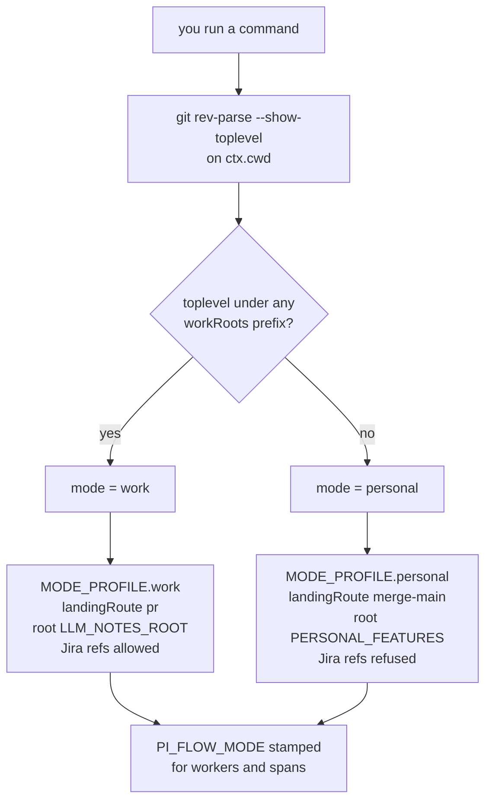
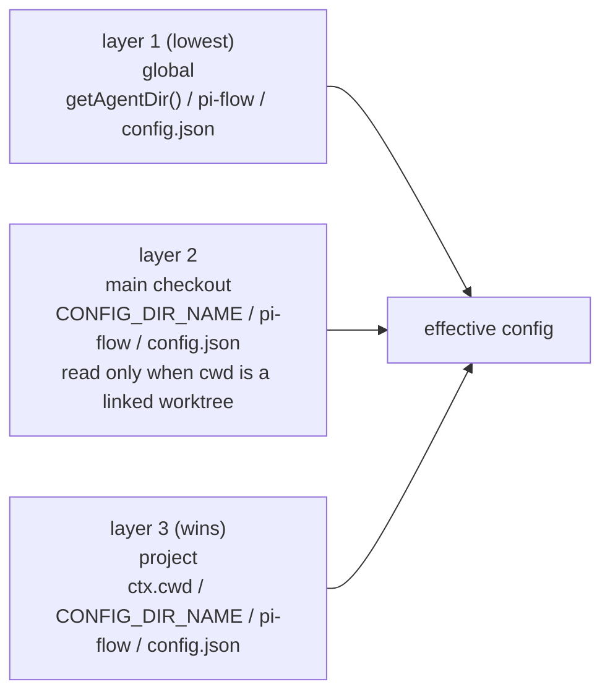
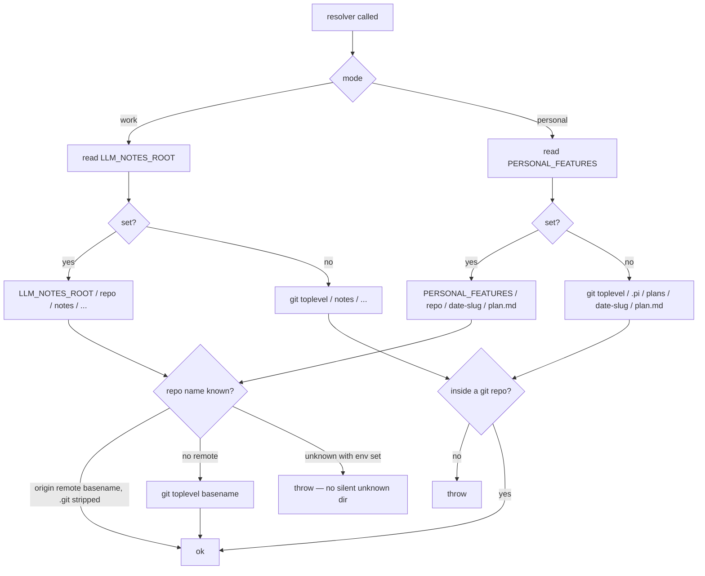
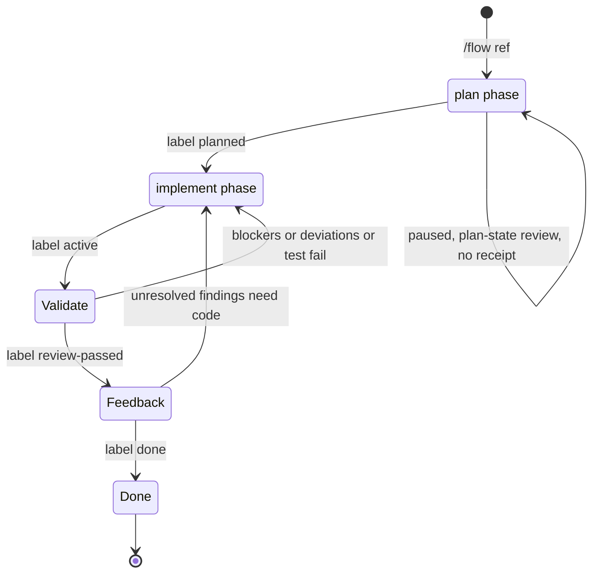
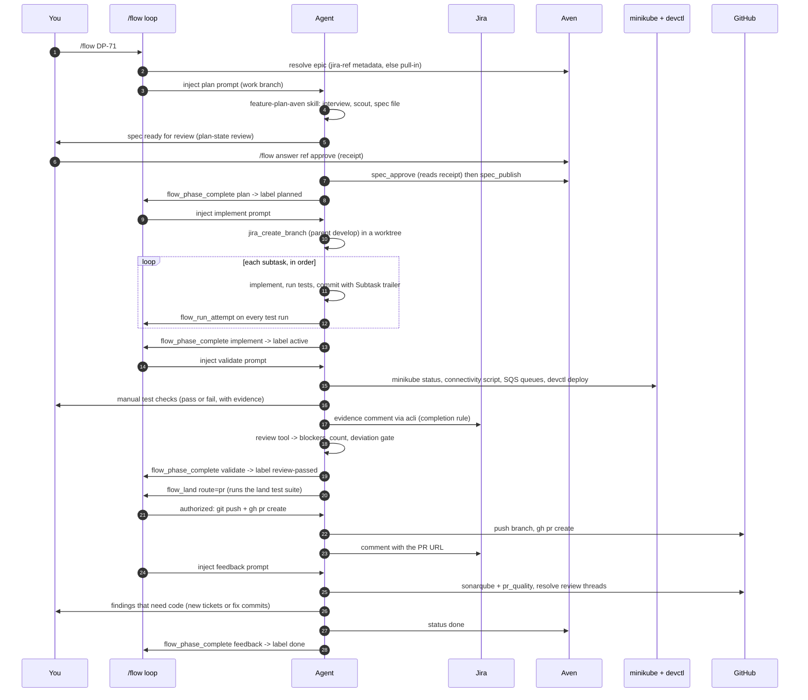
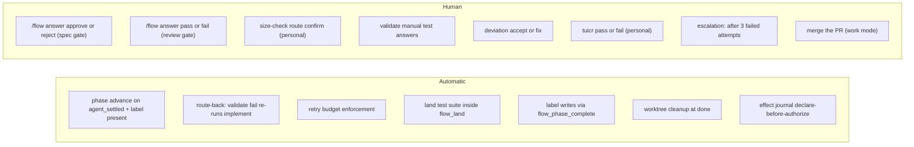
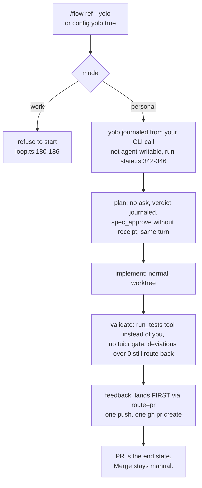

# PIV flow: work mode vs personal mode (visual map)

This page answers three questions:

1. Which mode am I in, and what decides it?
2. What happens in each phase, per mode?
3. What must **I** run, and what happens by itself?

Prose lives in the sibling docs. This page is the picture layer.

| Doc | Use it for |
| --- | --- |
| [`piv-flow.md`](piv-flow.md) | Canonical reference: commands, loop, escalation, cost, telemetry |
| [`piv-flow-work.md`](piv-flow-work.md) | Work-mode detail (Jira, cluster, PR) |
| [`piv-flow-personal.md`](piv-flow-personal.md) | Personal-mode detail (aven, worktree, local merge) |
| this page | Mode split, diagrams, "who acts" tables |

Verified 2026-11-22 against `packages/pi-flow`. Every claim has a `file:line`.

---

## 1. One rule splits the two modes

pi-flow does not ask you for the mode. It derives it from the path.



- The rule: `modeForToplevel(toplevel, workRoots)` — `work-mode.ts:8-16`. The match is path-segment aware. `/foo/bar` matches `/foo/barbaz`. Equality also matches.
- The wrapper: `resolveMode(pi, cwd)` — `config.ts:294-302`. It uses the **session cwd** (`ctx.cwd`), not `process.cwd()`.
- Call sites: `/flow` start (`index.ts:1492`), phase commands (`flow/phase-command.ts:149`), review tool (`review/review.ts:2106`, lazy at `:2631-2639`).
- **One site overrides the session mode.** The deviation gate ignores the model-supplied `mode` param and re-derives mode from the **flow worktree** toplevel — `tools/deviation.ts:143-149` (PMR-K74M). A failure there is a hard error. There is no silent fallback.

> **ADHD note:** mode = folder. Move the checkout, and you change mode. Nothing else about "work" vs "personal" is a switch you flip.

---

## 2. The mode table (the single source of truth)

`mode-profile.ts:36-53`. Every mode-keyed **value** lives here. Prose stays in the prompt modules.

| Field | work | personal | Where it is used |
| --- | --- | --- | --- |
| `landingRoute` | `pr` | `merge-main` | `validate/prompt.ts:106` |
| `baseResolution` | `recorded-sha` | `merge-base-local` | `tools/deviation.ts:171`, `validate/prompt.ts:60`, `review/review.ts:367` |
| `artifactRootEnv` | `LLM_NOTES_ROOT` | `PERSONAL_FEATURES` | `brainstorm/paths.ts:26` |
| `acceptsJiraRefs` | `true` | `false` | `index.ts:1495`, `brainstorm/refs.ts:37` |
| `branchRule` | `jira_create_branch` | `ref-prefixed-slug` | `worktree/branch.ts:184` |
| `phases` | plan, implement, validate, feedback | plan, implement, validate, feedback | `flow/orchestrate.ts:34` |

Both modes run all four phases. Personal `feedback` is a wrap-up phase (PMR-81SX), not a skip.

Mode-keyed decisions that are **not** in the table (they are prose or branch code):

| Site | Decision |
| --- | --- |
| `flow/loop.ts:180-186` | `--yolo` is refused in work mode |
| `plan/prompt.ts:69,82-83` | work delegates the whole skill; personal adds the size check and the oneshot escape |
| `implement/prompt.ts:45-53` | branch derivation + commit-subject ref rule |
| `validate/prompt.ts:135,236,255,417` | landing text, review gate, personal code-review gate |
| `validate/review-gate.ts:124` | work-mode review gate |
| `feedback/prompt.ts:208-216` | work PR gate vs personal wrap-up |
| `index.ts:1608` | work-only read of the epic `jira-ref` metadata |
| `worktree/index.ts:168-175` | flow ref injected into the personal branch name |
| `flow/cost.ts:704` | `/mode/work` cost routing |
| `run-state.ts:891`, `telemetry/index.ts:362` | mode validation; work-only telemetry attribute |

---

## 3. Settings: what gets picked up, and what wins

### 3.1 Config layers

pi-flow reads **three** files. Merge is whole-key, last-writer-wins. There is **no** field-level merge and **no** array concat.



- Loader: `loadConfigWithOrigins` — `config.ts:266-286`. Worktree detection uses `git rev-parse --git-common-dir` (`config.ts:207`).
- Provenance per key is recorded (`config.ts:250-282`), so `flow_land` can name the file that won.
- Validation: missing file = empty layer. Unreadable file, bad JSON, or a TypeBox failure = **throw**. No silent defaults (`config.ts:154-180`).
- Only `workRoots` is required (`config.schema.json`). When all layers are absent, it defaults to `[]` (`config.ts:275`), which makes every repo personal.

### 3.2 Config keys and their mode effect

| Key | Type | Default | Effect | Mode link |
| --- | --- | --- | --- | --- |
| `workRoots` | `string[]` | `[]` | Prefixes that define work mode | **defines** mode |
| `avenWorkspace` | `string` | unset | Forces the workspace on every aven call | personal + work |
| `yolo` | `boolean` | unset | Runs without confirmation gates | **personal only** — `--yolo` in work mode refuses the run (`loop.ts:180`) |
| `landTestCommand` | `string[]` | `["bun","run","test"]` | Command `flow_land` runs before it authorizes a landing | both modes |
| `viewerPlacement` | enum | `right` | Pane placement for `/flow-view` | both |
| `telemetry.*` | object | disabled | OTLP export; `jiraBaseUrl` adds ticket links to spans | `jiraBaseUrl` is work-only in effect (`telemetry/index.ts:362`) |
| `runServer.enabled` | `boolean` | `true` | Kill switch for the durable run daemon | both |

Precedence per setting:

| Setting | Winner order |
| --- | --- |
| Any config key | worktree project > main checkout > global |
| Aven workspace | explicit `--workspace` flag > config `avenWorkspace` > per-ref memoized resolution |
| Yolo | explicit `--yolo` flag > config `yolo` (work mode refuses both) |
| Artifact root | mode picks the env var; env unset = repo-local fallback |
| Gate mode | the flow worktree toplevel, never the model-supplied param |
| Ref kind | `aven:` / `jira:` prefix > registered aven project prefix > letter-digit heuristic |

### 3.3 Environment variables

Two groups. They never fall back to each other.

| Group | Vars | Who sets them |
| --- | --- | --- |
| Stamped by pi-flow (cleared on terminal transitions) | `PI_FLOW_REF`, `PI_FLOW_PHASE`, `PI_FLOW_MODE`, `PI_FLOW_TRACK_REF`, `PI_FLOW_TRACEPARENT`, `PI_FLOW_YOLO`, `PI_FLOW_SUBTASK` | `flow/attribution.ts:19-33,76,102` (`stampFlowStart`, `stampPhase`, `clearFlowEnv`) |
| Set by you or CI | `LLM_NOTES_ROOT`, `PERSONAL_FEATURES`, `PI_FLOW_PUSHGATEWAY_URL`, `PI_FLOW_PUSHGATEWAY_TOKEN`, `PI_FLOW_OTLP_TOKEN`, `HERDR_ENV`, `HERDR_WORKSPACE_ID`, `HERDR_PANE_ID`, `SONARQUBE_TOKEN`, `SONAR_PROJECT_KEY`, `SONAR_ORGANIZATION`, `SONAR_BASE_URL`, `PI_CODING_AGENT_DIR` | your shell, herdr, CI |

> Presence is the switch for the artifact roots. **No config key sets notes or plan paths.**

### 3.4 Path ladder per mode



Concrete shapes:

| What | work | personal | Source |
| --- | --- | --- | --- |
| Main doc | `LLM_NOTES_ROOT/<repo>/notes/specs/<JIRA>__<slug>.md` (fallback `<toplevel>/notes/specs/…`) | `$PERSONAL_FEATURES/<repo>/<YYYY-MM-DD>-<slug>/plan.md` (fallback `<toplevel>/.pi/plans/<date>-<slug>/plan.md`) | `plan-tools/helpers.ts:83-105`, `:155-177` |
| Extra files | — | `scout-context.md`, `review.md` in the plan.md directory | repo `AGENTS.md` flow-doc section |
| Brainstorm | `<root>/<repo>/notes/brainstorm/` — root is mode-keyed | same rule, personal root | `brainstorm/paths.ts:26-45` |
| Generic notes | `<root>/<repo>/notes[/<subdir>]` — subdir allowlist: `""`, `prs`, `specs`, `research`, `tickets` | same, repo-local | `helpers.ts:112-118`, `:125-147` |

---

## 4. Phases and state: labels are the run state

There is no flow database. Aven labels **are** the state. `nextPhase` = the first phase whose completion label is missing.



| Phase | Completion label | Who writes it | Gate that must pass first |
| --- | --- | --- | --- |
| plan | `planned` | `flow_phase_complete(phase=plan)` | work: none extra · personal plan route: human approve receipt · personal oneshot: exempt |
| implement | `active` | `flow_phase_complete(phase=implement)` | all subtask work green and committed; retry budget 3 not exhausted |
| validate | `review-passed` | `flow_phase_complete(phase=validate)` | mode gate chain (section 5 and 6) |
| feedback | `done` | `flow_phase_complete(phase=feedback)` | every finding fixed or ticketed (work) · outcome summary exists (personal) |

Rules that hold in both modes:

- Direct edits of lifecycle labels are blocked in bash (`flow/label-gate.ts`). `flow_phase_complete` is the only writer.
- Labels are created at session start, best effort (`index.ts:632`, `aven/client.ts:819-845`): `planned, active, review-passed, done` + types `bug, oneshot, plan` (`phase-state.ts:15-18`).
- Kill the session at any point. Re-run `/flow <ref>`. It resumes at the first missing label. That is also why a completed phase is never re-run.
- On any halt, the loop writes the aven note `flow halted at <phase>: <reason>` and leaves labels untouched (`flow/loop.ts:355`).
- A validate fail path writes a note with `reviewed-at: <sha>` and stops. The loop sees that marker and re-runs implement (bounded). The route-back is **code**, not an agent decision (`PMR-69V8`, `validate/prompt.ts` AIDEV note).

---

## 5. Work mode, end to end

Ref: a Jira ID (`DP-71`) or an aven ref. A bare Jira ID pulls in a local epic first.



### 5.1 Work-mode gates per phase

| Phase | Gate | You or agent | Source |
| --- | --- | --- | --- |
| plan | size check | none — work has no size check | `plan/prompt.ts:82-88` |
| plan | spec approval | **you**: `/flow answer <ref> approve` | `plan/prompt.ts:40-65` |
| implement | retry budget | agent reports every attempt; 3 total, then **you** | `implement/prompt.ts:20-27`, `tools/run-attempt.ts` |
| validate 1 | minikube running | agent, bounded poll | `validate/prompt.ts:468-472` |
| validate 2 | `test-services-connectivity.sh` exit 0 | agent | `:473` |
| validate 3 | `add-sqs-queues.sh` exit 0 | agent | `:474` |
| validate 4 | devctl deploy of affected services | agent (devctl skill) | `:475-476` |
| validate 5 | manual test checks | **you** answer pass/fail | `:477-479` |
| validate 6 | Jira evidence comment | agent via acli — the phase is not complete until it lands | `:480-486` |
| validate 7 | review blockers `blockers_count == 0` | reviewer subagent; **you** if it fails twice | `buildReviewGateSection` (`validate/prompt.ts:100`) |
| validate 8 | spec deviation `deviations_count == 0` | reviewer subagent; **you** accept or fix | `buildDeviationGateSection` (`validate/prompt.ts:230`) |
| validate 9 | `flow_land(route=pr)` green suite | automatic | `tools/land.ts:866,897` |
| feedback | every Sonar + GitHub finding fixed or ticketed | agent, **you** decide scope | `feedback/prompt.ts:30-68` |

Scripts dir rule: `<workRoots[0]>/sh-devctl/scripts` (`validate/paths.ts:14-20`). No `workRoots` = a loud config error, never a guess.

### 5.2 Work mode: what you run

| You run | When | Why |
| --- | --- | --- |
| `/flow <jira-id>` | start, or resume | starts or resumes the run |
| `/flow answer <ref> approve` | plan pause | records the approval receipt |
| pass/fail answers | validate step 5 | manual test results |
| accept/fix answer | deviation gate | deviation decision |
| `/flow <ref>` again | after a halt or a route-back | resumes at the first missing label |
| merge the PR on GitHub | after feedback | pi-flow never merges |

Nothing in work mode merges to main. Landing is always a PR.

---

## 6. Personal mode, end to end

Ref: an aven ref only. A Jira ID is refused with "Jira IDs are work-mode only" (`index.ts:1495-1497`).

```mermaid
sequenceDiagram
    autonumber
    participant You
    participant Flow as /flow loop
    participant Agent
    participant Aven
    participant WT as git worktree
    participant Main as main checkout

    You->>Flow: /flow PMR-AB12
    Flow->>Agent: inject plan prompt (personal branch)
    Agent->>Aven: aven show ref, aven context ref --full
    Agent->>You: size check verdict: oneshot or plan
    You->>Agent: confirm the route
    alt oneshot
        Agent->>Aven: label oneshot, status todo, description is the plan
        Agent->>Flow: flow_phase_complete plan -> label planned (no receipt)
    else plan route
        Agent->>Agent: feature-plan-aven: scout, planner, plan.md
        Agent->>Aven: plan-state review
        Note over Flow: loop pauses: snapshot paused, state cleared
        You->>Aven: /flow answer ref approve (receipt)
        You->>Flow: /flow ref (restart; auto-resume is PMR-DMHH)
        Agent->>Aven: spec_approve then spec_publish
        Agent->>Flow: flow_phase_complete plan -> label planned
    end
    Flow->>Agent: inject implement prompt
    Agent->>WT: worktree tool -> branch feat/REF-slug (ref injected)
    loop each subtask
        Agent->>WT: implement, run tests, commit type scope [REF] subject
        Agent->>Flow: flow_run_attempt on every test run
    end
    Agent->>Flow: flow_phase_complete implement -> label active
    Flow->>Agent: inject validate prompt
    Agent->>You: composed human test steps (pass or fail)
    Agent->>Agent: review tool -> blockers_count (base = local merge-base with flowbase)
    Agent->>Agent: deviation gate (spec = plan.md, or the description for oneshot)
    Agent->>You: code_review tool opens tuicr -> pass or fail
    You->>Agent: pass
    Agent->>Flow: flow_phase_complete validate -> label review-passed
    Agent->>Flow: flow_land route=merge-main (runs the land test suite)
    Flow->>Agent: pinned command: git -C main-repo merge --ff-only branch
    Agent->>Main: run the pinned command, alone, never a push
    Flow->>Agent: inject feedback prompt (wrap-up)
    Agent->>Main: verify ancestry: merge-base --is-ancestor branch main
    Agent->>Aven: outcome summary note, review-feedback tickets
    Agent->>Aven: status done
    Agent->>Flow: flow_phase_complete feedback -> label done
    Flow->>WT: cleanup worktree (automatic, plus a merged-worktree sweep)
```

### 6.1 Personal-mode gates per phase

| Phase | Gate | You or agent | Source |
| --- | --- | --- | --- |
| plan | size-check route confirm | **you** | `plan/prompt.ts:95-101` |
| plan | oneshot exemption | automatic — no receipt, no `plan.md` | `plan/prompt.ts:102-110` |
| plan | spec approval | **you**: `/flow answer <ref> approve` | `plan/prompt.ts:119-127`, `tools/phase-complete.ts:142-197` |
| implement | worktree, never the main checkout | agent | `implement/prompt.ts:21` |
| implement | retry budget 3 | agent reports; **you** on escalation | `tools/run-attempt.ts` |
| validate 1 | human runs the composed test steps | **you** | `validate/personal.ts:39-67`, `validate/prompt.ts:434-452` |
| validate 2 | review blockers `== 0` | reviewer subagent | `buildReviewGateSection('personal')` |
| validate 3 | deviations `== 0` | reviewer subagent; **you** accept or fix | `buildDeviationGateSection('personal')` |
| validate 4 | human code review (tuicr) | **you** — hard gate | `buildPersonalCodeReviewGate` (`validate/prompt.ts:181-201`), `tools/code-review.ts` |
| validate 5 | `flow_land(merge-main)` green suite + a human pass record | automatic checks | `tools/land.ts:793-831` |
| feedback | merge ancestry verified before the outcome summary | agent | `feedback/prompt.ts:74-202` |

Base rule: personal BASE_SHA = `git merge-base HEAD <flowbase>` — the **local** base, never the base's upstream ref. Reason: personal never pushes, so upstream lags local main (`validate/prompt.ts:52-60`, `MODE_PROFILE.baseResolution`).

### 6.2 Personal mode: what you run

| You run | When | Why |
| --- | --- | --- |
| `/flow <aven-ref>` | start | starts the run |
| confirm the route | plan | oneshot vs plan |
| `/flow answer <ref> approve` then `/flow <ref>` | plan pause | approve, then restart (see PMR-DMHH) |
| the test steps, then pass/fail | validate 1 | you are the test environment |
| review in tuicr, then pass/fail | validate 4 | final human look |
| `/flow answer <ref> pass` | validate 4, cross-session | durable pass when the pane is not available |
| `/flow <ref>` again | after any halt or route-back | resume at the first missing label |

You never merge by hand. The agent runs the pinned `git -C <main> merge --ff-only <branch>`. If that fails, it stops and asks you (no force, no rebase).

---

## 7. Side by side: same phase, different action

| Step | work | personal |
| --- | --- | --- |
| Ref you type | Jira ID or aven ref | aven ref only |
| Jira ID handling | local epic, `jira-ref` metadata, dep-linked to the synced ticket (`flow/jira-ref.ts`) | refused (`index.ts:1495-1497`) |
| Plan artifact | `notes/specs/<JIRA>__<slug>.md` | `<repo>/<date>-<slug>/plan.md` |
| Plan skill | `feature-plan-aven` unchanged | size check, then the same skill |
| Oneshot escape | none | yes (`oneshot` label, no receipt) |
| Branch | `jira_create_branch` tool, parent `develop` | `feat/<REF>-<slug>` via the worktree tool |
| Worktree | always | always |
| Commit message | conventional, Jira link | `type(scope): [REF] subject` |
| Validate evidence | minikube, scripts, devctl deploy, manual checks, Jira comment | human runs composed steps |
| Diff base | recorded `flowbasesha` (`baseResolution: recorded-sha`) | local merge-base with the `flowbase` branch, never upstream (`baseResolution: merge-base-local`) |
| Review gate | review tool + deviation gate | review tool + deviation gate + **tuicr human gate** |
| Land | `flow_land(route=pr)` → authorized `git push` + `gh pr create` | `flow_land(route=merge-main)` → pinned local `merge --ff-only` |
| Push | yes, one push | **never** |
| PR | yes, plus a Jira comment with the URL | no PR, no Jira |
| Feedback | Sonar + PR threads → fix or new task | outcome summary, review-feedback tickets, `done` |
| End state | open PR, you merge it | main advanced locally, worktree cleaned |
| `--yolo` | refused | allowed; skips approval, human-test, and code-review gates |
| Telemetry ticket link | `jiraBaseUrl` on spans | aven ref only |

---

## 8. You vs the machine



The loop never answers a gate on your behalf. The model never sequences phases by itself. That split is the design.

**Two known ceremony costs:**

1. Paused at plan means the loop is torn down. Today you restart it with `/flow <ref>` after you approve. See ticket PMR-DMHH.
2. The loop only wakes on a real model turn. Slash commands (including `/flow answer`) are deliberately **not** a model turn (`flow/answer.ts:1-6`).

---

## 9. Yolo: a third shape, personal only



- `isYoloRun(ref)` reads the journaled projection. Absent or unreadable = not yolo (fail-closed, `run-state.ts:1040`).
- Yolo personal mode lands through a **PR**, not the local merge: the feedback
  prompt owns the whole landing sequence (`feedback/prompt.ts:129-158`,
  `yoloPersonalFeedbackSection` at `:137`, routed at `:210`). That is the one
  place personal mode pushes. It never merges — the open PR is the end state.

---

## 10. Command cheat sheet

| Command | Mode | What it does |
| --- | --- | --- |
| `/flow <ref>` | both | run the remaining phases (loop, `index.ts:1291`) |
| `/flow` | both | open the gate picker for all open gates |
| `/flow --yolo` | personal | same, without confirmation gates |
| `/flow answer <ref> approve\|reject` | both | spec-gate receipt (`flow/answer.ts:19-30`) |
| `/flow answer <ref> pass\|fail` | both | review-gate record |
| `/flow dashboard` | both | pin the flow dashboard |
| `/plan`, `/implement`, `/validate`, `/feedback` | both | one phase only; no loop armed (`flow/phase-command.ts:189-270`) |
| `/brainstorm <topic>` | both | explore, then a confirm-gated ticket (Jira in work, aven in personal) |
| `/flow-view`, `/flow-view-replay` | both | inspect journal state |
| `/flow-cost <ref>` | both | per-ticket cost rollup |

Prefixes force ref kind when a name is ambiguous: `aven:PMR-AB12`, `jira:DP-71` (`flow/ref-kind.ts:39-59`).

---

## 11. Where the mode can bite you (gotchas)

| Symptom | Cause | Fix |
| --- | --- | --- |
| `/flow DP-71` says "Jira IDs are work-mode only" | your toplevel is not under `workRoots` | add the prefix to `workRoots`, or use an aven ref |
| validate stops with a config error about scripts | `workRoots` is empty, so `sh-devctl/scripts` will not resolve | set `workRoots[0]` to the parent of `sh-devctl` |
| Plans land inside the repo instead of your notes root | `PERSONAL_FEATURES` / `LLM_NOTES_ROOT` unset for that mode | export the var, or accept the repo-local fallback |
| Notes land in `<root>/unknown/` — no, they throw | repo name cannot be derived (no origin remote, no toplevel) | add a remote or run inside the checkout |
| `aven show --json` shows no metadata | aven 0.1.39 omits it — pi-flow parses the `--full` heredoc blocks instead | always use `aven show <ref> --full` |
| deviation gate refuses with "cannot resolve the flow worktree" | the bound worktree moved, or you run it from the session checkout | re-bind by `/flow <ref>`; never retry with a hand-written diff |
| config change has no effect | a closer layer pins the same key | whole-key replacement: check `pi-flow/config.json` in the worktree, then the main checkout, then global |
| `git push` is blocked in a personal flow | correct: `route=merge-main` never authorizes a push | run the pinned merge command that `flow_land` returns |
| flow will not advance after approval | the loop is paused, not dead-waiting | re-run `/flow <ref>` |

---

## 12. See also

- `packages/pi-flow/mode-profile.ts` — the mode table, first file to read
- `docs/piv-flow.md` §1, §5, §6 — mode detection, landing, the loop
- `docs/piv-flow-work.md` — work-mode detail
- `docs/piv-flow-personal.md` — personal-mode detail
- `docs/herdr-flow-integration.md` — panes, worktrees, viewer
- Ticket PMR-DMHH — auto-resume on the approval receipt (removes ceremony step 8.1)
