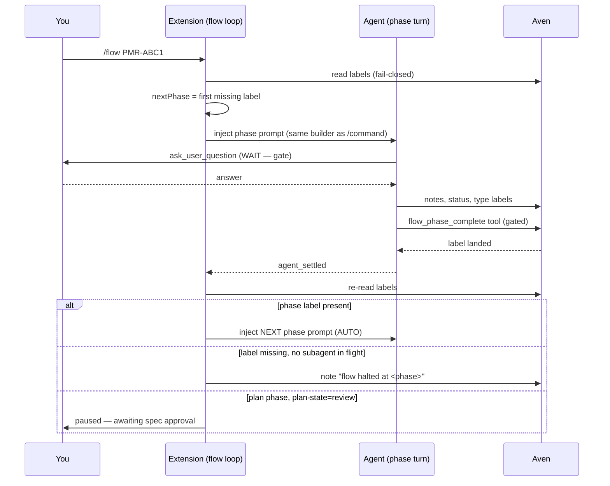

# RPIV flow, personal mode: the complete map

Deep-dive companion to [`rpiv-flow.md`](rpiv-flow.md). That doc covers both
modes; this one explains **personal mode only** — every transition, every
status change, every label, and above all: **where the flow advances by
itself and where it stops and waits for you**.

Everything here is read from the source of truth:
`packages/pi-flow/flow/loop.ts`, `flow/orchestrate.ts`, `flow/phase-prompts.ts`,
`flow/label-gate.ts`, `flow/land-gate.ts`, `plan/prompt.ts`, `plan/size-check.ts`,
`plan/split-gate.ts`, `research/prompt.ts`, `research/ticket-gate.ts`,
`implement/prompt.ts`, `implement/routing.ts`, `implement/retry.ts`,
`validate/personal.ts`, `validate/review-gate.ts`, `validate/prompt.ts`,
`feedback/prompt.ts`, `feedback/triage.ts`, `run-state.ts`, `gates.ts`,
`work-mode.ts`, and the tool wiring in `index.ts`.

---

## 1. When you are in personal mode

Every `/flow`, `/research`, `/plan`, `/implement`, `/validate`, `/feedback`
command first runs `git rev-parse --show-toplevel` on the session cwd.
`modeForToplevel` checks that path against the `workRoots` prefixes in
`~/.pi/agent/pi-flow/config.json`:

- Toplevel **under** any workRoot prefix (path-segment aware: `/foo/bar`
  does not match `/foo/barbaz`) → **work mode**.
- Everything else → **personal mode**.

A repo like `~/Code/personal/pi-my-rifle-ext` is personal because it is not
under `/home/geert/Code/salaryhero`. Personal mode also refuses Jira IDs
outright — `/flow DP-71` in a personal repo notifies
`Jira IDs are work-mode only (this repo is personal) — use an aven ref`.

What personal mode changes, in one table:

| Concern | Work mode | Personal mode |
| --- | --- | --- |
| Ticket tracker | Jira (acli) + local aven epic | aven only |
| Plan phase | `feature-plan-aven` skill | pi-flow's own size-check + split-confirm flow |
| Validate environment | minikube cluster gate | **you are the test environment** |
| Landing | PR via gh | **push straight to main** (standing no-PR rule) |
| Feedback | /sonarqube + /pr-quality triage | re-review + outcome summary note |

---

## 2. Why the flow is shaped this way

The design is a stack of deliberate decisions, each traceable to a source
file. Understanding these makes every gate below obvious instead of
arbitrary.

| Decision | Why |
| --- | --- |
| **Aven labels ARE the run state** (`flow/orchestrate.ts`) | The first phase whose completion label is missing is the phase to run. One rule gives you resume (kill the flow mid-phase → label absent → the same phase re-runs) and no-duplicate-work (label present → phase skipped). No separate state machine to corrupt. |
| **The extension sequences phases, never the model** (`flow/loop.ts`) | An agent cannot invoke slash commands. The old "driver agent that runs /research like a human" prompt just made the agent wander. Now extension code injects one phase prompt at a time and advances on the `agent_settled` event when the label has landed. |
| **Lifecycle labels are tool-gated** (`flow/label-gate.ts`, `index.ts`) | `aven edit <ref> --label planned` from the agent's bash is intercepted and blocked. Only `flow_phase_complete` can write `researched/planned/active/review-passed/done`, and it re-checks phase order first. An out-of-order or premature label is structurally impossible. |
| **Landing is gated** (`flow/land-gate.ts`, `index.ts`) | While a flow run is active, `git push` / `gh pr create` in bash are blocked until `flow_land` verifies the `review-passed` label (and cross-checks the review artifact's `blockers_count`). Broken code cannot auto-land. |
| **Retry budget 3 is tool-owned** (`implement/retry.ts`, `index.ts`) | The agent reports every test attempt to `flow_run_attempt`; the tool decides retry vs escalate. Counting attempts "in its head" is how agents burn 10 retries at 3am. |
| **Every decomposition waits for your "Confirm"** (`research/ticket-gate.ts`, `plan/split-gate.ts`) | A pure function returns a plan object only when `confirmed === true`. Creating a ticket or splitting a ticket into an epic tree without your explicit answer is impossible by construction. |
| **The human is the test environment** (`validate/personal.ts`) | No cluster exists for personal repos. Test steps are composed from the plan/research artifacts — and if those sections are all empty, the agent must STOP rather than invent generic filler steps. |
| **Fail closed everywhere** | Aven unreadable → abort, never "start from research by accident". Malformed `blockers_count` → error, never treated as 0. Unknown severity in feedback → new task, never a silent fix. |
| **Push to main, no PR** (`validate/review-gate.ts`) | Own repos, standing no-PR rule; the review gate substitutes for PR review before the direct push. |
| **Notes are the durable evidence record** | Every gate answer, failure, halt, and outcome lands as an aven note on the ref, so any later session can reconstruct what happened. The journal (`~/.pi/agent/pi-flow/runs/`) additionally records the run projection for the Herdr viewer. |

---

## 3. The whole flow at a glance

Legend: **AUTO** = the loop advances by itself once the phase turn settles
and the label landed. **WAIT** = the turn blocks on you; nothing proceeds
until you answer.

```mermaid
flowchart TD
    start["/flow PMR-ABC1"] --> rd{"researched OR<br/>research-skipped<br/>label present?"}
    rd -- "no" --> res["RESEARCH phase<br/>question loop (WAIT per question)<br/>scouts (async)<br/>artifact in notes/research/"]
    rd -- "yes (skip)" --> pln
    res --> tg{"ticket exists?"}
    tg -- "no: /research topic" --> tgate["TICKET-CREATION GATE<br/>WAIT — explicit Confirm<br/>aven workspace + project"]
    tgate -- confirmed --> lblR["label: researched<br/>type label: feature|bug"]
    tg -- "yes: /flow ref" --> lblR2["label: researched<br/>(gate skipped, ticket exists)"]
    lblR --> pln
    lblR2 --> pln
    pln["PLAN phase<br/>existing-tree check → size check<br/>split verdict presented"]
    pln --> split["SPLIT CONFIRM<br/>WAIT — oneshot vs plan"]
    split -- oneshot --> osh["label: oneshot<br/>description IS the plan"]
    split -- plan --> epic["ticket becomes epic<br/>subtasks created<br/>label: plan<br/>plan.md written"]
    osh --> psr["status: todo<br/>plan-state: review<br/>plan.md opens in herdr pane"]
    epic --> psr
    psr --> appr["APPROVAL GATE<br/>WAIT — /spec-review, then you say<br/>'approve PMR-ABC1'<br/>spec_approve → plan-state=approved"]
    appr --> lblP["label: planned<br/>(flow_phase_complete)"]
    lblP --> impl["IMPLEMENT phase<br/>worktree + feat/slug branch<br/>route: bug | plan | oneshot"]
    impl --> tests{"tests green in<br/>≤ 3 attempts?<br/>(flow_run_attempt)"}
    tests -- "3rd fail" --> esc["status: blocked<br/>evidence note<br/>ESCALATE to you"]
    tests -- green --> lblA["label: active<br/>(flow_phase_complete)"]
    lblA --> val["VALIDATE phase<br/>test steps composed from artifacts"]
    val --> htest{"HUMAN TEST<br/>WAIT — you run the steps<br/>pass | fail"}
    htest -- fail --> bk["failure note<br/>route back to /implement<br/>retry budget RESET"]
    bk --> impl
    htest -- pass --> note2["aven note:<br/>'validated by human, date'"]
    note2 --> rev["REVIEW GATE<br/>/review (fresh context)<br/>blockers_count artifact"]
    rev -- "count &gt; 0" --> bl["blocker notes<br/>route back to /implement"]
    bl --> impl
    rev -- "count = 0" --> lblV["label: review-passed<br/>(flow_phase_complete)"]
    lblV --> land["flow_land route=push-main<br/>authorizes the push"]
    land --> push["git push to main<br/>(now unblocked)"]
    push --> fb["FEEDBACK phase"]
    fb --> rerev{"validate produced<br/>post-review fixes?"}
    rerev -- yes --> rr["re-run /review<br/>same triage rules"]
    rerev -- no --> summ
    rr --> summ["OUTCOME SUMMARY note<br/>What shipped / Test evidence /<br/>Review verdict"]
    summ --> done["status: done<br/>label: done<br/>(flow_phase_complete)<br/>AUTO: flow complete"]

    style tgate fill:#f9d71c
    style split fill:#f9d71c
    style appr fill:#f9d71c
    style htest fill:#f9d71c
    style esc fill:#ff6b6b
    style start fill:#9ad3ff
    style push fill:#c7f0bd
    style done fill:#c7f0bd
```



Yellow = waits for you. Red = escalated to you. Green = terminal events.

### 3.1 Who advances what



Key mechanic: **blocking `ask_user_question` calls keep the run in flight**,
so the loop never races a gate — `agent_settled` only fires after you have
answered. Fire-and-forget scout subagents also settle the run mid-phase;
the `hasInFlightSubagent` guard recognizes that as an async wait and keeps
the loop armed instead of halting.

---

## 4. The run-state vocabulary

### 4.1 Lifecycle labels — the phase ledger

Set ONLY via the `flow_phase_complete` tool, which re-checks that every
earlier phase is complete first. Direct `aven edit --label <lifecycle>` is
intercepted and blocked.

| Phase completes | Label lands | Set by |
| --- | --- | --- |
| research | `researched` | `flow_phase_complete(phase="research")` |
| plan | `planned` | `flow_phase_complete(phase="plan")` — only AFTER spec approval |
| implement | `active` | `flow_phase_complete(phase="implement")` |
| validate | `review-passed` | `flow_phase_complete(phase="validate")` |
| feedback | `done` | `flow_phase_complete(phase="feedback")` |

```mermaid
stateDiagram-v2
    [*] --> researched: research phase done
    researched --> planned: plan phase + YOUR approval
    planned --> active: implement green + committed
    active --> review-passed: human test passed + /review clean
    review-passed --> done: outcome summary written
    researched --> research_skipped_label: --skip-research (alternative entry)
    research_skipped_label --> planned
    active --> active: validate fail → implement again<br/>(budget reset)
    active --> active: review blockers → implement again
```

### 4.2 Type and skip labels — the routing contract

`bug`, `oneshot`, `plan` route `/implement`; `research-skipped` is the
durable record that research was deliberately skipped (gates read labels,
never notes — a note alone would be invisible). These stay agent-writable,
unlike lifecycle labels.

| Label | When it appears | Effect |
| --- | --- | --- |
| `bug` | research debug flow (ticket creation, or pre-existing) | implement runs reproduce-first bug flow |
| `oneshot` | plan phase, split confirmed oneshot | implement runs a single implement→test→commit cycle |
| `plan` | plan phase, split confirmed plan | implement walks the epic tree via `implement-plan-aven` |
| `research-skipped` | `--skip-research` flag (recorded by /flow loop or /implement command) | research gate satisfied forever after; the flag is never re-demanded |

One override: if the ref is an **epic with open children**, implement forces
the `plan` route even when labels say oneshot — an oneshot prompt over an
open tree would batch the whole tree into one cycle with no per-task workers.

### 4.3 Ticket status changes

Aven status (backlog / todo / in-progress / blocked / done) is secondary to
labels, but the flow does move it:

| Moment | Status |
| --- | --- |
| Ticket created at research gate | `backlog` |
| Plan enters spec review (step 6, both routes) | `todo` |
| `spec_approve` | `todo` (pinned again) |
| Implement retry budget exhausted | `blocked` + evidence note + escalate |
| Feedback, outcome summary note exists | `done` |

Phases never set `done` early: the implement prompt explicitly forbids it —
later phases own that transition.

### 4.4 Metadata and notes — the evidence layer

| Field | Meaning |
| --- | --- |
| `plan-state=review` / `approved` | plan-phase approval gate state, set by the plan prompt / `spec_approve` tool |
| `plan-path=...` | where plan.md lives, recorded at plan time so later phases find it |
| aven notes | every gate confirmation, skip, failure, halt, human validation, outcome summary |
| `~/.pi/agent/pi-flow/runs/<ref>.json` (+ `.journal.jsonl`) | per-run event journal + projection; labels remain the gate source of truth, the journal is the display/evidence record (`/flow-view` renders it) |

---

## 5. Phase by phase

### 5.1 Research — understand before proposing

**Entry variants (personal mode):**

- `/flow PMR-ABC1` — the ref itself is the topic; the ticket already exists,
  so the creation gate is moot and the `researched` label lands on the ref.
- `/research <topic>` — free topic; artifact written, then the
  ticket-creation gate runs.
- `/research --debug <symptom>` — drives your `debug` skill to a root cause
  (hypothesis chain + evidence sections); if a ticket is created it gets the
  `bug` label.
- `--skip-research` on `/flow`/`/implement` — the loop itself records the
  durable `research-skipped` label + note before starting at plan.

**Steps:** one-question-at-a-time interview (each answer is a WAIT) →
parallel scout subagents (async; if codegraph is available it is synced and
named in scout tasks) → artifact to
`$LLM_NOTES_ROOT/<repo>/notes/research/<date>-<slug>.md`, else
`<git-toplevel>/notes/research/…`, with Questions / Findings / Diagrams /
Ticket implications sections (debug: Hypothesis chain / Evidence) → gate.

**WAIT — ticket-creation gate.** The agent proposes an aven workspace AND
project via `ask_user_question` and requires an explicit "Confirm" before
`aven ticket create` runs. Decline → nothing is created, period. Confirm →
ticket created with the type label (`bug` for debug flow, `feature`
otherwise) and a note `confirmed by user, destination <destination>`.

**Exit:** `flow_phase_complete(phase="research")` → `researched` label.
The flow then AUTO-advances to plan.

### 5.2 Plan — decompose, but only with your permission

Personal plan never touches the `feature-plan-aven` skill; it is pi-flow's
own flow:

1. Fetch the ticket + notes.
2. **Existing-tree check**: `aven epic list`. Children already exist → this
   is an existing epic, NEVER decomposed again. You get the child list and
   confirm it is current; add/remove children or encode execution order as
   dependency links if you ask. plan.md is refreshed, then skip to step 6.
3. **Size check** (`classifySize`, pure heuristic): signals for data model /
   migration / schema, cross-package, or multi-step (integration/E2E,
   several suites) → `plan`; no signals → `oneshot`.
4. **WAIT — split confirm.** The verdict with its reasons is presented via
   `ask_user_question`. No decomposition happens without your explicit
   confirm — enforced by `buildEpicSplitPlan` returning null unless
   `confirmed === true`.
5. Branch on your answer:
   - **oneshot**: `oneshot` type label, no epic, the description IS the
     plan; no plan file.
   - **plan**: ticket becomes the epic (`aven edit <ref> --epic on`),
     subtasks created (`aven add … --status backlog`, `aven epic add`),
     `plan` type label, plan.md written to
     `$PERSONAL_FEATURES/<repo>/<date>-<slug>/plan.md` or
     `<git-toplevel>/.pi/plans/<date>-<slug>/plan.md`, location recorded as
     `plan-path` metadata, and the file opened in a herdr nvim pane
     (`open_in_pane`, skippable — never blocks).
6. **Spec review, both routes**: status → `todo`, metadata
   `plan-state=review`. The `planned` label is NOT set yet — a premature
   `planned` would misroute `/implement`, which routes oneshot vs plan from
   type labels only after approval.
7. **WAIT — approval gate.** You review via `/spec-review` (the session
   becomes the reviewer and fixes spec issues in place); approval happens
   only when you explicitly say "approve PMR-ABC1", which the `spec_approve`
   tool executes: `plan-state=approved`, `plan` label pinned, status `todo`.
   If the ticket was already `plan-state=approved` in an earlier run, the
   resume check skips straight to completion.

**How the loop treats this wait:** when the plan turn settles without
`planned` while `plan-state=review`, that is the expected approval gate, not
a failure — the flow **pauses** with an info note
("awaiting spec approval … then rerun /flow"), not a halt. After you approve
and re-run `/flow`, it resumes at plan; the refreshed prompt completes the
phase and `planned` lands.

**Exit:** `flow_phase_complete(phase="plan")` → `planned` label → AUTO to
implement.

### 5.3 Implement — isolated, budgeted, committed

**Gate** (checked before any prompt is even built): no `planned` label →
refuse ("run /plan first"). No `researched` and no `research-skipped` label
→ the explicit `--skip-research` flag is required, and the flag is
immediately recorded as the durable `research-skipped` label so it is never
asked for again.

**Routing:** `bug` label → reproduce-first flow (write the failing test
first, fix, suite green, commit). `plan` label (or epic with open children)
→ the `implement-plan-aven` skill walks subtasks in dependency order, each
with its own test run + commit, never starting a blocked subtask. Default →
oneshot: one implement→test→commit cycle.

**Hard rules for every route:**

- **Worktree isolation**: all work happens in an isolated git worktree; the
  main checkout is read-only. Personal branch: `feat/<slug>` from the ticket
  slug.
- **Retry budget 3**: every test attempt is reported to `flow_run_attempt`.
  Attempts 1–2 failing → retry (the tool tells the agent how many are left).
  3rd failure → tool error "ESCALATE", evidence note (commands, last error,
  hypothesis) on the ref, status `blocked`, and further attempts are
  refused until a human restarts. A pass clears the budget.
- **Each task = implement → tests → commit**; done only when green AND
  committed. Conventional commit subjects.

**Exit:** `flow_phase_complete(phase="implement")` → `active` label → AUTO
to validate.

### 5.4 Validate — you run the tests; /review decides landing

No cluster, no devctl, no acli in personal mode. Two stages:

**Stage 1 — human test.** The agent locates the plan/research artifacts
(what changed, plan validation notes, research findings), composes numbered
steps you can literally run plus the expected outcome. All sections empty →
STOP, the artifacts are missing; filler steps are never invented.

**WAIT — pass/fail question.** Two options: "pass" and "fail".

- pass → aven note `validated by human, <date>` → stage 2.
- fail → you give a short failure description → aven note → route back to
  `/implement` with the **retry budget reset** (a new fix cycle deserves a
  fresh budget).

**Stage 2 — review gate (both modes).** `/review` runs with a fresh-context
reviewer. The verdict must be written machine-readable: exactly one line
`blockers_count: <N>` plus one `- blocker: <description>` per blocker.
Parsing is strict and scoped to the verdict section — a missing, duplicated,
or non-integer count is an ERROR (re-run /review), never a silent 0, because
a silent 0 would auto-land broken code.

- `blockers_count > 0` → each blocker becomes an aven note; route back to
  `/implement` (budget applies); do not land.
- `blockers_count: 0` → `flow_phase_complete(phase="validate")` lands
  `review-passed`, then `flow_land ref route=push-main` re-checks the gate
  (label required, artifact cross-checked when supplied) and authorizes the
  landing — only then does `git push` to main pass the interceptor.

**Exit:** `review-passed` label + pushed branch → AUTO to feedback.

### 5.5 Feedback — the audit trail, then done

- If validate produced fixes after its review, `/review` re-runs on the
  final state; blockers follow the same triage rules as work mode
  (mechanical → fix + commit; anything behavioral/architectural/data, any
  major+, any unknown severity → a NEW ticket through the full flow gates —
  never a silent fix, never ignored).
- The **outcome summary** note is written on the ref: `## Outcome summary`
  with `### What shipped`, `### Test evidence`, `### Review verdict`. Any
  empty section → STOP and ask you, never filler.
- Only once that note exists: status `done` AND
  `flow_phase_complete(phase="feedback")` → `done` label.

**Exit:** the loop sees all five labels → AUTO: "all phases complete", run
ends.

---

## 6. Auto-advance vs wait-for-you — the complete matrix

| # | Point | Kind | What happens without you |
| --- | --- | --- | --- |
| 1 | Research interview (each question) | WAIT | Run stays in flight; nothing proceeds |
| 2 | Ticket-creation gate | WAIT | Nothing is created if you decline |
| 3 | Phase settled + label landed | AUTO | Next phase prompt injected immediately |
| 4 | Plan split confirm (oneshot vs plan) | WAIT | No epic, no subtasks, ever |
| 5 | Plan approval (`plan-state=review`) | WAIT | Flow PAUSES (info note); re-run `/flow` after approving |
| 6 | plan.md review in herdr pane | optional | `open_in_pane` is skippable; never blocks |
| 7 | Implement test attempts | AUTO | Agent works the budget itself; you only see progress |
| 8 | Retry budget exhausted | ESCALATE | status `blocked`, evidence note, STOP — you restart |
| 9 | Validate human test (pass/fail) | WAIT | Run stays in flight until you answer |
| 10 | Validate fail → re-implement | AUTO (after your answer) | Back to implement, budget reset |
| 11 | Review gate parse/decision | AUTO | 0 → land; >0 → back to implement with notes |
| 12 | Landing (`flow_land` ok) | AUTO | Agent pushes to main immediately |
| 13 | Feedback outcome summary | AUTO | Note written from real evidence; empty section → STOP and ask |
| 14 | All labels present | AUTO | Flow complete; `/flow` re-run says "nothing to run" |

---

## 7. Every stop, halt, and loop-back path

| Event | State effect | What you do |
| --- | --- | --- |
| Phase settled without its label (and no subagent in flight) | aven note `flow halted at <phase>: …`; labels untouched (ref stays at last good label) | Fix the cause, re-run `/flow <ref>` — it resumes at the failed phase |
| Plan settles without `planned`, `plan-state=review` | PAUSE (info note, not a halt) | Review via `/spec-review`, say "approve <REF>", re-run `/flow` |
| Aven unreadable at any decision point | Fail-closed abort/halt | Fix aven (the message names the fix), re-run `/flow` |
| Implement: 3rd failed test attempt | `flow_run_attempt` escalation error + note; status `blocked`; more attempts refused | Investigate, then restart (session restart or a passing attempt clears the budget) |
| Validate human test "fail" | Failure note; route back to `/implement`; budget reset | Answer the fail question with a description; the flow loops |
| Review blockers > 0 | Blocker notes; route back to `/implement` | Fix cycle, then validate re-runs the review gate |
| Malformed `blockers_count` | Tool error, never a silent 0 | Re-run `/review` |
| `git push` / `gh pr create` before `flow_land` | Bash interceptor blocks the command, names the active ref | Complete validate, call `flow_land` |
| Direct lifecycle label edit via bash | Blocked: "extension-governed" | Use `flow_phase_complete` |
| New `/flow` while one is active | Info note "superseding active flow for X with Y" | Intentional — the new ref takes over |
| Session killed mid-flow | Nothing lost — labels are durable; journal has the projection | Just re-run `/flow <ref>` |

---

## 8. Enforcement boundary — the four tools and two interceptors

| Guard | Mechanism |
| --- | --- |
| `flow_phase_complete(ref, phase)` | ONLY writer of lifecycle labels; re-checks phase order (`checkPhaseCompletion`); idempotent ("already recorded") |
| `flow_run_attempt(ref, result)` | Owns the 3-attempt budget in memory; decides retry vs escalate; escalation = tool error + aven note + blocked |
| `flow_land(ref, route, artifact?)` | Re-checks `review-passed` (+ artifact verdict) at the landing boundary; authorizes exactly that ref's push |
| `spec_approve(ref)` | ONLY writer of `plan-state=approved` (requires your explicit "approve <REF>"); pins `plan` label, status `todo`; then `/spec-publish` |
| bash interceptor #1 | Blocks `aven edit/label` writes of lifecycle labels while any flow is registered |
| bash interceptor #2 | Blocks `git push` / `gh pr create` while the loop has an active ref, until `flow_land` authorized it |

---

## 9. Quick reference (personal mode)

```text
/flow PMR-ABC1                 # run/resume the whole flow at the first missing label
/flow PMR-ABC1 --skip-research # durable skip label, start at plan
/research <topic>              # standalone research + ticket gate
/research --debug <symptom>    # root-cause flow, bug label
/plan PMR-ABC1                 # size check + split confirm + spec review
/implement PMR-ABC1            # gated: needs planned; worktree + budget
/validate PMR-ABC1             # you test, then /review decides landing
/feedback PMR-ABC1             # outcome summary, then done
/spec-review                   # list + review specs at plan-state=review
/flow-view PMR-ABC1            # render the run journal in Herdr
aven show PMR-ABC1 --full      # the label ledger is the run state
```

Artifact paths:

| Artifact | Path |
| --- | --- |
| Research artifact | `$LLM_NOTES_ROOT/<repo>/notes/research/<date>-<slug>.md`, else `<git-toplevel>/notes/research/…` |
| plan.md | `$PERSONAL_FEATURES/<repo>/<date>-<slug>/plan.md`, else `<git-toplevel>/.pi/plans/<date>-<slug>/plan.md` |
| Run journal | `~/.pi/agent/pi-flow/runs/<ref>.json` + `<ref>.journal.jsonl` |
| Config | `~/.pi/agent/pi-flow/config.json` (`workRoots`, `avenWorkspace`) |
| Branch | `feat/<slug>` (slug: lowercase, alphanumeric, max 5 words, dashes) |

---

## See also

- [`rpiv-flow.md`](rpiv-flow.md) — the canonical two-mode reference.
- [`rpiv-flow-work.md`](rpiv-flow-work.md) — work-mode deep dive (Jira↔aven
  epic mirror, cluster gate, PR landing).
- [`aven-feature-flow.md`](aven-feature-flow.md) — the epic-tree contract
  used by the plan route inside implement.
- [`herdr-flow-integration.md`](herdr-flow-integration.md) — the run journal
  and `/flow-view`.
- `packages/pi-flow/README.md` — package layout and configuration.
