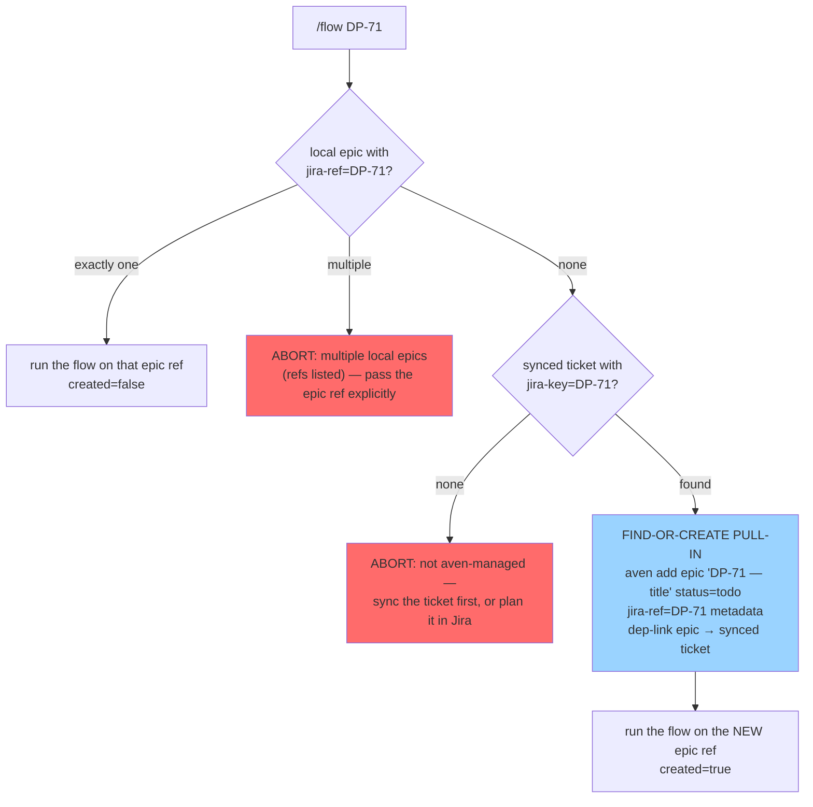
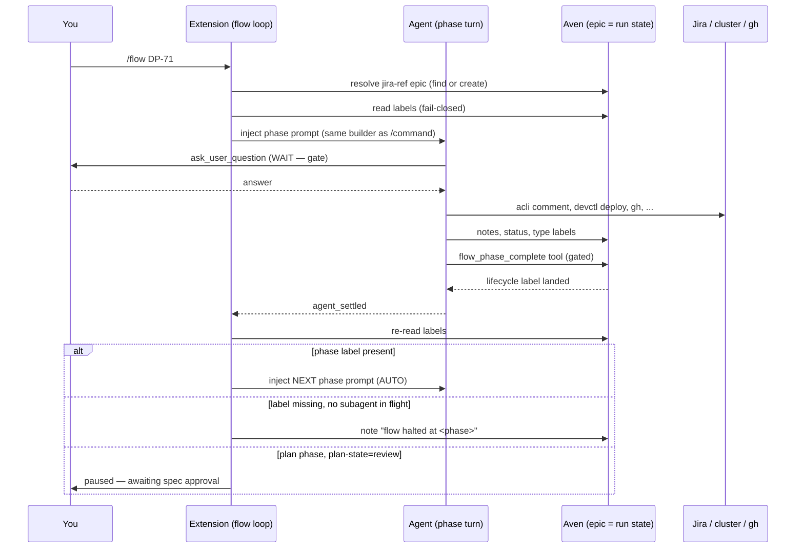

# RPIV flow, work mode: the complete map

Deep-dive companion to [`rpiv-flow.md`](rpiv-flow.md), and the work-mode
sibling of [`rpiv-flow-personal.md`](rpiv-flow-personal.md). That pair of
docs covers the shared machinery; this one explains **work mode only** —
every transition, every status change, every label, and above all: **where
the flow advances by itself and where it stops and waits for you**.

Everything here is read from the source of truth:
`packages/pi-flow/flow/loop.ts`, `flow/orchestrate.ts`, `flow/phase-prompts.ts`,
`flow/jira-ref.ts`, `flow/label-gate.ts`, `flow/land-gate.ts`,
`plan/prompt.ts`, `research/prompt.ts`, `research/ticket-gate.ts`,
`implement/prompt.ts`, `implement/routing.ts`, `implement/retry.ts`,
`validate/gate.ts`, `validate/review-gate.ts`, `validate/prompt.ts`,
`feedback/prompt.ts`, `feedback/triage.ts`, `run-state.ts`, `gates.ts`,
`work-mode.ts`, and the tool wiring in `index.ts`.

---

## 1. When you are in work mode

Every `/flow`, `/research`, `/plan`, `/implement`, `/validate`, `/feedback`
command first runs `git rev-parse --show-toplevel` on the session cwd.
`modeForToplevel` checks that path against the `workRoots` prefixes in
`~/.pi/agent/pi-flow/config.json`:

- Toplevel **under** any workRoot prefix (path-segment aware: `/foo/bar`
  does not match `/foo/barbaz`; equality counts) → **work mode**.
- Everything else → personal mode.

A repo like `/home/geert/Code/salaryhero/<repo>` is work mode because the
prefix `/home/geert/Code/salaryhero` is a configured workRoot.

What work mode changes, in one table:

| Concern | Personal mode | Work mode |
| --- | --- | --- |
| Ticket tracker | aven only | **Jira is the source of truth**; a local aven epic mirrors each Jira ticket and carries the flow labels |
| Refs you can pass | aven refs only | aven refs **and Jira IDs** (`DP-71`), plus explicit `jira:`/`aven:` prefixes |
| Plan phase | pi-flow's size-check flow | **`feature-plan-aven` skill** (interview, scout, planner, plan.md, epic tree, plan-state approval) |
| Validate environment | you are the test environment | **ordered cluster gate**: minikube → connectivity → queues → deploy → manual tests → Jira evidence comment |
| Landing | push straight to main | **PR via gh** + Jira comment linking it |
| Feedback | re-review + outcome note | **/sonarqube + /pr-quality** triage over the PR |

### 1.1 The two-ledger design: Jira is the ticket, the epic is the run state

Work mode's defining trick: Jira stays the human system of record, while
**all flow labels, journal, and halt notes live on a local aven epic** that
mirrors the Jira ticket. The link between them is exactly two things (the
shared contract with the planning skills):

| Metadata | Meaning |
| --- | --- |
| `jira-ref=<JIRA-ID>` on the local epic | this epic runs the flow for that Jira ticket |
| `jira-key=<JIRA-ID>` on a synced aven ticket | the Jira content was synced into aven (aven's own sync, not pi-flow's) |
| dep-link epic ↔ synced ticket | the epic depends on the synced ticket; `/research` follows it to reach the Jira description |

Why: labels are the run state (resume, gating, `/flow` advancement all read
them), and Jira has no label store aven can read synchronously. One ledger
per ticket, readable in one call, still dep-linked back to Jira.

### 1.2 Jira-ID resolution (`flow/jira-ref.ts`)

`/flow DP-71` needs a real aven ref **before** the plan phase runs, so the
extension resolves or creates the epic itself:



Failure recovery is built in: if the epic was created but the dep-link
failed, the abort message says re-run `/flow` — the epic will be found and
reused (detection is by aven output text, because aven prints errors with
exit 0).

**Pull-in inheritance:** if the epic was just created and a prior
*pure-Jira* research artifact exists (`findResearchedArtifact` in
`notes/research/`), the extension best-effort marks the new epic
`researched` with a note naming the artifact — research done before an aven
ref existed is not lost, and `/flow` resumes past research.

**Phase commands resolve read-only:** `/implement DP-71` resolves an
existing epic and reads its labels; a miss passes the Jira ID through
unchanged — `/plan DP-71` cold still lets the `feature-plan-aven` skill do
its own pull-in. Only `/flow` creates epics.

---

## 2. Why the flow is shaped this way (work-mode specifics)

The mode-agnostic decisions (labels as run state, extension-owned loop,
tool-gated lifecycle labels, gated landing, retry budget 3, fail-closed
everywhere) are explained in
[`rpiv-flow-personal.md` §2](rpiv-flow-personal.md) — they apply unchanged.
On top of those, work mode adds:

| Decision | Why |
| --- | --- |
| **The local epic mirrors the Jira ticket** (`flow/jira-ref.ts`) | One durable label ledger per ticket, readable synchronously; Jira remains the source of truth for humans. The contract with the planning skills is exactly two metadata keys + a dep-link — no coupling beyond that. |
| **`/flow` resolves the epic itself; phase commands stay read-only** | The loop needs a ref before plan runs, but creating tickets from a read-only command would surprise. Creation happens in exactly one place. |
| **Planning and plan-route implementation delegate to skills BY NAME** (`plan/prompt.ts`, `implement/prompt.ts`) | `feature-plan-aven` and `implement-plan-aven` already encode the epic-tree contract, plan-state gate, and Jira pull-in. pi-flow reuses them by name and never reimplements them — the shared phase-prompt builders guarantee the loop and the manual commands produce identical handoffs. |
| **`planned` lands only after the approval-gated tree stage** (`plan/prompt.ts` WORK_SUFFIX) | `/implement` routes oneshot vs plan from type labels; a premature `planned` would misroute the run. Approval is the spec gate: plan-state draft → review → approved (`spec_approve`). |
| **Validate is an ordered, frozen state machine** (`validate/gate.ts`) | Six mandatory steps in a fixed order; once a step fails, the gate state refuses to advance — no later success can silently clear an earlier failure. The **Jira evidence comment is the last step**, so validation can never pass without the evidence landing in Jira. |
| **Bounded minikube poll** (`DEFAULT_POLL_CONFIG`: 12 attempts, 10s apart) | Never hang the flow on a cluster that will not start — exhaust the bound, fail the gate, surface it. |
| **Manual tests are collected, not assumed** | Each planned manual check is a pass/fail question to you; a single fail fails the gate. |
| **Landing is a PR, and the PR lands in Jira** (`validate/review-gate.ts`) | Work code needs review history; the Jira comment linking the PR closes the evidence loop started by the validate gate's comment. |
| **Feedback triage: mechanical fixes vs new tasks, nothing silent** (`feedback/triage.ts`) | minor/style/naming that touch nothing behavioral are fix-and-commit; anything mentioning behavior/architecture/data/migrations/schema/API contracts — regardless of severity — plus every major/critical/blocker and every *unknown* severity becomes a NEW ticket through the full flow gates. Severity labels lie more often than descriptions do; unknown escalates fail-closed. |

---

## 3. The whole flow at a glance

Legend: **AUTO** = the loop advances by itself once the phase turn settles
and the label landed. **WAIT** = the turn blocks on you; nothing proceeds
until you answer.

```mermaid
flowchart TD
    start["/flow DP-71 or PMR-EPIC"] --> resolve["Jira-ID resolution<br/>(see diagram 1.2)<br/>fail-closed label read"]
    resolve --> rd{"researched OR<br/>research-skipped<br/>label present?"}
    rd -- "no" --> res["RESEARCH phase<br/>question loop (WAIT per question)<br/>scouts (async)<br/>artifact in notes/research/"]
    rd -- "yes" --> pln
    res --> tg{"what was the input?"}
    tg -- "topic (no ticket)" --> tgate["TICKET-CREATION GATE<br/>WAIT — explicit Confirm<br/>Jira project via acli"]
    tgate -- confirmed --> lblR2["new Jira ticket + local flow<br/>label: researched, type: feature|bug"]
    tg -- "ID=DP-71 / jira-shaped" --> tres["TICKET RESEARCH<br/>no creation gate<br/>epic → synced → acli fallback"]
    tres --> lblR["label: researched<br/>(epic or synced ticket)"]
    lblR --> pln
    lblR2 --> pln
    pln["PLAN phase<br/>feature-plan-aven skill<br/>pickup, interview (WAIT), scout,<br/>planner subagent, plan.md"]
    pln --> tree["aven phase/subtask epic tree<br/>plan-state: draft → review"]
    tree --> appr["APPROVAL GATE<br/>WAIT — you review plan.md,<br/>say 'approve REF' → spec_approve<br/>plan-state=approved"]
    appr --> lblP["status: todo<br/>label: planned<br/>(flow_phase_complete)"]
    lblP --> impl["IMPLEMENT phase<br/>worktree + jira_create_branch<br/>route: bug | plan | oneshot"]
    impl --> tests{"tests green in<br/>≤ 3 attempts?<br/>(flow_run_attempt)"}
    tests -- "3rd fail" --> esc["status: blocked<br/>evidence note<br/>ESCALATE to you"]
    tests -- green --> lblA["label: active<br/>(flow_phase_complete)"]
    lblA --> val["VALIDATE phase<br/>ordered cluster gate"]
    val --> g1["1 minikube (12x10s bounded)<br/>2 connectivity script<br/>3 SQS queues script"]
    g1 --> g2["4 deploy via devctl skill"]
    g2 --> g3["5 manual tests<br/>WAIT — pass/fail per check<br/>one fail fails the gate"]
    g3 --> g4["6 Jira evidence comment<br/>phase passes ONLY after it lands"]
    g4 -- "any step failed" --> gf["STOP: aven note with<br/>step + full output<br/>gate FROZEN"]
    gf --> reval["fix, re-run /validate"]
    g4 -- "all six green" --> rev["REVIEW GATE<br/>/review (fresh context)<br/>blockers_count artifact"]
    rev -- "count &gt; 0" --> bl["blocker notes<br/>route back to /implement"]
    bl --> impl
    rev -- "count = 0" --> lblV["label: review-passed<br/>(flow_phase_complete)"]
    lblV --> land["flow_land route=pr<br/>authorizes push + PR"]
    land --> push["git push, gh pr create<br/>Jira comment linking the PR"]
    push --> fb["FEEDBACK phase"]
    fb --> sq["/sonarqube + /pr-quality<br/>+ unresolved GitHub comments"]
    sq --> tri{"triage each finding<br/>(classify: severity + description)"}
    tri -- "mechanical, non-behavioral" --> fix["fix + commit"]
    tri -- "behavioral / major+ / unknown" --> newt["NEW ticket through the<br/>full flow gates — never silent"]
    fix --> summ["report final counts<br/>every finding resolved"]
    newt --> summ
    summ --> done["status: done<br/>label: done<br/>(flow_phase_complete)<br/>AUTO: flow complete"]

    style tgate fill:#f9d71c
    style appr fill:#f9d71c
    style g3 fill:#f9d71c
    style esc fill:#ff6b6b
    style gf fill:#ff6b6b
    style start fill:#9ad3ff
    style push fill:#c7f0bd
    style done fill:#c7f0bd
```



Yellow = waits for you. Red = escalated/frozen. Green = terminal events.

### 3.1 Who advances what



Key mechanic: **blocking `ask_user_question` calls keep the run in flight**,
so the loop never races a gate. Fire-and-forget scout/planner subagents also
settle the run mid-phase; the `hasInFlightSubagent` guard treats that as an
async wait and keeps the loop armed. Phase sequencing is extension code —
the model never decides what runs next.

---

## 4. The run-state vocabulary

### 4.1 Lifecycle labels — the phase ledger (on the epic)

Set ONLY via the `flow_phase_complete` tool, which re-checks that every
earlier phase is complete first. Direct `aven edit --label <lifecycle>` is
intercepted and blocked.

| Phase completes | Label lands on the epic | Set by |
| --- | --- | --- |
| research | `researched` | `flow_phase_complete(phase="research")` — on the local epic, or on the synced ticket when no epic exists yet (an artifact marker lets a later epic inherit it) |
| plan | `planned` | `flow_phase_complete(phase="plan")` — only AFTER spec approval |
| implement | `active` | `flow_phase_complete(phase="implement")` |
| validate | `review-passed` | `flow_phase_complete(phase="validate")` |
| feedback | `done` | `flow_phase_complete(phase="feedback")` |

```mermaid
stateDiagram-v2
    [*] --> researched: research phase done
    researched --> planned: plan phase + YOUR approval
    planned --> active: implement green + committed
    active --> review-passed: cluster gate + manual tests<br/>+ /review clean
    review-passed --> done: feedback triage complete
    researched --> research_skipped_label: --skip-research (alternative entry)
    research_skipped_label --> planned
    active --> active: validate step fail → fix → re-validate
    active --> active: manual test fail / review blockers → implement again
```

### 4.2 Type and skip labels — the routing contract

`bug`, `oneshot`, `plan` route `/implement`; `research-skipped` is the
durable record that research was deliberately skipped. These stay
agent-writable, unlike lifecycle labels.

| Label | When it appears | Effect |
| --- | --- | --- |
| `bug` | research debug flow | implement runs reproduce-first bug flow |
| `oneshot` | plan phase, small split | implement runs a single implement→test→commit cycle |
| `plan` | plan phase, epic tree built | implement walks the tree via `implement-plan-aven` |
| `research-skipped` | `--skip-research` flag (recorded durably by the loop or the /implement command) | research gate satisfied forever after; the flag is never re-demanded |

One override: if the ref is an **epic with open children**, implement forces
the `plan` route even when labels say oneshot — an oneshot prompt over an
open tree would batch the whole tree into one cycle with no per-task workers.

### 4.3 Ticket status changes

| Moment | Status |
| --- | --- |
| Research gate creates the Jira ticket | normal Jira workflow state |
| Pull-in creates the local epic (`/flow DP-71` cold) | `todo` |
| Plan completes (approval + `planned`) | `todo` on the epic |
| Implement retry budget exhausted | `blocked` + evidence note + escalate |
| Feedback, all findings resolved | `done` |

Phases never set `done` early: the implement prompt explicitly forbids it —
later phases own that transition.

### 4.4 Metadata and notes — the evidence layer

| Field | Meaning |
| --- | --- |
| `jira-ref=<id>` (epic) / `jira-key=<id>` (synced ticket) | the Jira↔aven mirror contract |
| `plan-state=draft/review/approved` | plan-phase approval gate state |
| `plan-path=...` | where plan.md lives |
| dep-link epic ↔ synced ticket | how ticket research reaches the Jira description (`aven show --full`; plain `--json` has no description field) |
| aven notes | every gate confirmation, skip, failure, halt, evidence |
| `~/.pi/agent/pi-flow/runs/<ref>.json` (+ `.journal.jsonl`) | run journal + projection for `/flow-view`; labels remain the gate source of truth |

---

## 5. Phase by phase

### 5.1 Research — understand before proposing

**Entry variants (work mode):**

- `/flow DP-71` — the extension resolves/creates the local epic (§1.2) and
  researches the ticket: aven epic first (read the dep-linked synced ticket
  for the description), synced aven ticket second (content already in aven,
  no Jira fetch needed), `acli jira workitem view` fallback. **No
  ticket-creation gate — the ticket exists.**
- `/research <topic>` — free topic; artifact + ticket-creation gate.
- `/research ID=DP-71` (or a bare jira-shaped topic in work mode) — ticket
  research, same resolution ladder as `/flow`.
- `/research --debug <symptom>` — drives your `debug` skill to a root cause;
  a ticket created at the gate gets the `bug` label.
- `--skip-research` on `/flow`/`/implement` — the loop records the durable
  `research-skipped` label + note before starting at plan.

**Steps:** one-question-at-a-time interview (each answer is a WAIT) →
parallel scout subagents (async; codegraph is synced and named in scout
tasks when available) → artifact to
`$LLM_NOTES_ROOT/<repo>/notes/research/<date>-<slug>.md`, else
`<git-toplevel>/notes/research/…`, with Questions / Findings / Diagrams /
Ticket implications sections (debug: Hypothesis chain / Evidence) → gate.

**WAIT — ticket-creation gate** (topic flow only). The agent proposes the
most likely Jira project key via `ask_user_question` and requires an
explicit "Confirm" before `acli jira workitem create` runs. Decline →
nothing is created. Confirm → ticket created with the type label (`bug` for
debug flow, `feature` otherwise) and a `> confirmed by user, destination
<project>` line appended to the artifact header.

**Label placement:** on the epic when it exists (the normal case); on the
synced ticket when research ran before any epic existed — plus the artifact
marker `> researched by pi-flow on <date>` so a later `/flow DP-71` pull-in
or epic-creation inherits research instead of re-running it. Pure-Jira
research (no aven ref at all) cannot land a label; the marker in the
artifact is the record, inherited at pull-in time.

**Exit:** `flow_phase_complete(phase="research")` → `researched` label.
The flow then AUTO-advances to plan.

### 5.2 Plan — the feature-plan-aven skill owns this phase

Work mode does NOT run pi-flow's size-check flow. The phase prompt invokes
your `feature-plan-aven` skill **by name** and follows it exactly:

1. **Pickup**: the ticket is picked up into the aven workspace routed to
   the current directory (Jira IDs get the pull-in there if the epic does
   not exist yet).
2. **Interview** (WAIT per question) + scout + planner subagent.
3. **plan.md** written; **aven phase/subtask epic tree** built.
4. **Spec review**: plan-state draft → `review`; you review (the session
   fixes spec issues in place during `/spec-review`).
5. **WAIT — approval gate.** Approval only on your explicit "approve
   <REF>": the `spec_approve` tool sets `plan-state=approved`, pins the
   `plan` label, status `todo`. Then `/spec-publish` publishes the plan.

**Exit:** only after approval, status `todo` + `flow_phase_complete(phase="plan")`
→ `planned` label. A premature `planned` would misroute `/implement`.
If you do not approve during the phase, the ticket stays at
`plan-state=review` without `planned`; when the loop observes that state it
**pauses** (info note: approve, then re-run `/flow`) — it resumes at plan
afterwards.

### 5.3 Implement — isolated, budgeted, committed

**Gate** (checked before any prompt is even built): no `planned` label →
refuse ("run /plan first"). No `researched` and no `research-skipped` label
→ the explicit `--skip-research` flag is required, and the flag is
immediately recorded as the durable `research-skipped` label so it is never
asked for again.

**Routing:** `bug` label → reproduce-first flow (failing test first, fix,
suite green, commit). `plan` label (or epic with open children) → the
`implement-plan-aven` skill walks subtasks in dependency order, never
starting a blocked subtask, each subtask with its own test run + commit.
Default → oneshot: one implement→test→commit cycle.

**Hard rules for every route:**

- **Worktree isolation**: all work happens in an isolated git worktree; the
  main checkout is read-only. Work branch: created via the
  `jira_create_branch` tool from the Jira ref (type → prefix, summary →
  slug, git-town parent `develop`).
- **Retry budget 3**: every test attempt is reported to `flow_run_attempt`.
  Attempts 1–2 failing → retry (the tool reports what is left). 3rd failure
  → tool error "ESCALATE", evidence note (commands, last error, hypothesis)
  on the ref, status `blocked`, further attempts refused until a human
  restarts. A pass clears the budget.
- **Each task = implement → tests → commit**; done only when green AND
  committed. Conventional commit subjects.

**Exit:** `flow_phase_complete(phase="implement")` → `active` label → AUTO
to validate.

### 5.4 Validate — the ordered cluster gate, then /review

Work mode validates against the local minikube cluster. **Six mandatory
steps, never reordered, never skipped** (`validate/gate.ts`):

| # | Step | Detail |
| --- | --- | --- |
| 1 | minikube | `minikube status`; if not Running, `minikube start` + bounded poll — at most **12 attempts, 10s apart**, then the gate FAILS (never hangs) |
| 2 | connectivity | `<first workRoot>/sh-devctl/scripts/test-services-connectivity.sh` — must exit 0 |
| 3 | SQS queues | `…/add-sqs-queues.sh` — must exit 0 |
| 4 | deploy | the `devctl` skill deploys the affected services from the plan's validation notes |
| 5 | manual tests | **WAIT** — each planned check is a pass/fail question to you; one fail fails the gate |
| 6 | Jira evidence comment | via acli, describing HOW the change was validated — what was deployed, which tests ran, evidence |

The phase passes **ONLY after the Jira comment from step 6 lands**. On ANY
step failure: STOP, aven note with the step name + full failing output —
and the gate is **frozen**: the pure state machine refuses to advance past
a recorded failure; no later success silently clears it. Fix, re-run
`/validate`; it restarts at the failed step.

**Then the review gate (both modes).** `/review` runs with a fresh-context
reviewer. The verdict must be written machine-readable: exactly one line
`blockers_count: <N>` plus one `- blocker: <description>` per blocker.
Parsing is strict and scoped to the verdict section — a missing, duplicated,
or non-integer count is an ERROR (re-run /review), never a silent 0, because
a silent 0 would auto-land broken code.

- `blockers_count > 0` → each blocker becomes an aven note; route back to
  `/implement` (budget applies); do not land.
- `blockers_count: 0` → `flow_phase_complete(phase="validate")` lands
  `review-passed`, then `flow_land ref route=pr` re-checks the gate and
  authorizes the landing — push the branch, create the PR via pi-review's
  gh tooling, and post a Jira comment on the ref linking the PR URL.

**Exit:** `review-passed` label + PR exists → AUTO to feedback.

### 5.5 Feedback — triage the PR, nothing silent

1. Run `/sonarqube` on the PR (pi-review, by name) and read the report.
2. **Triage every unresolved finding** (`feedback/triage.ts` `classify`):
   - Mechanical severities (`minor`, `style`, `naming`) that do NOT touch
     behavior, architecture, data, migrations, schema, or API contracts →
     fix immediately via `/pr-quality` semantics and COMMIT each fix.
   - Anything behavioral/architectural/data-touching — regardless of
     severity — every major/critical/blocker, and every finding whose
     severity cannot be determined → a **NEW Jira/aven task that goes back
     through the full flow gates**. Never a silent fix, never ignored.
3. Unresolved GitHub review comments on the PR: same triage rules; reply to
   comments you escalated, linking the new task.

**Completion rule:** every finding is fixed-and-committed or escalated as a
new task; the agent reports final counts, then status `done` AND
`flow_phase_complete(phase="feedback")` → `done` label.

**Exit:** the loop sees all five labels → AUTO: "all phases complete", run
ends.

---

## 6. Auto-advance vs wait-for-you — the complete matrix

| # | Point | Kind | What happens without you |
| --- | --- | --- | --- |
| 1 | Research interview (each question) | WAIT | Run stays in flight; nothing proceeds |
| 2 | Ticket-creation gate (topic flow only) | WAIT | Nothing is created if you decline |
| 3 | Phase settled + label landed | AUTO | Next phase prompt injected immediately |
| 4 | Plan interview (feature-plan-aven) | WAIT | Run stays in flight per question |
| 5 | Plan approval (`plan-state=review`) | WAIT | Flow PAUSES (info note); re-run `/flow` after approving |
| 6 | Implement test attempts | AUTO | Agent works the budget itself; you only see progress |
| 7 | Retry budget exhausted | ESCALATE | status `blocked`, evidence note, STOP — you restart |
| 8 | Validate steps 1–4 (minikube→deploy) | AUTO | Scripts and devctl run without you; failures freeze the gate |
| 9 | Validate step 5 manual tests | WAIT | Run stays in flight until every check is answered |
| 10 | Validate step 6 Jira comment | AUTO | acli posts it; phase passes only when it lands |
| 11 | Review gate parse/decision | AUTO | 0 → land; >0 → back to implement with notes |
| 12 | Landing (`flow_land` ok) | AUTO | Agent pushes, creates the PR, links it in Jira |
| 13 | Feedback triage decisions | AUTO | fix-now vs new-task by the classify rules; counts reported |
| 14 | All labels present | AUTO | Flow complete; `/flow` re-run says "nothing to run" |

---

## 7. Every stop, halt, and loop-back path

| Event | State effect | What you do |
| --- | --- | --- |
| Jira-ID resolution: multiple epics | Abort, refs listed | Pass the epic ref explicitly |
| Jira-ID resolution: not aven-managed | Abort | Sync the ticket first, or plan it in Jira directly |
| Epic created but dep-link failed | Abort with recovery note | Re-run `/flow` — the epic is found and reused |
| Phase settled without its label (and no subagent in flight) | aven note `flow halted at <phase>: …`; labels untouched (ref stays at last good label) | Fix the cause, re-run `/flow <ref>` — it resumes at the failed phase |
| Plan settles without `planned`, `plan-state=review` | PAUSE (info note, not a halt) | Review, say "approve <REF>", re-run `/flow` |
| Aven unreadable at any decision point | Fail-closed abort/halt | Fix aven (the message names the fix), re-run `/flow` |
| Implement: 3rd failed test attempt | `flow_run_attempt` escalation error + note; status `blocked`; more attempts refused | Investigate, then restart (session restart or a passing attempt clears the budget) |
| Validate step failure | Aven note with step + output; gate FROZEN at that step | Fix, re-run `/validate` — restarts at the failed step |
| Manual test "fail" | Gate failed at step 5, note recorded | Fix cycle; validate re-runs from the failed step |
| Review blockers > 0 | Blocker notes; route back to `/implement` | Fix cycle, then validate re-runs the review gate |
| Malformed `blockers_count` | Tool error, never a silent 0 | Re-run `/review` |
| `git push` / `gh pr create` before `flow_land` | Bash interceptor blocks the command, names the active ref | Complete validate, call `flow_land` |
| Direct lifecycle label edit via bash | Blocked: "extension-governed" | Use `flow_phase_complete` |
| New `/flow` while one is active | Info note "superseding active flow for X with Y" | Intentional — the new ref takes over |
| Session killed mid-flow | Nothing lost — labels are durable; journal has the projection | Just re-run `/flow <ref>` |

---

## 8. Enforcement boundary — the four tools and two interceptors

Identical machinery in both modes (the boundary is mode-agnostic):

| Guard | Mechanism |
| --- | --- |
| `flow_phase_complete(ref, phase)` | ONLY writer of lifecycle labels; re-checks phase order (`checkPhaseCompletion`); idempotent ("already recorded") |
| `flow_run_attempt(ref, result)` | Owns the 3-attempt budget in memory; decides retry vs escalate; escalation = tool error + aven note + blocked |
| `flow_land(ref, route, artifact?)` | Re-checks `review-passed` (+ artifact verdict) at the landing boundary; work mode authorizes `route=pr` |
| `spec_approve(ref)` | ONLY writer of `plan-state=approved` (requires your explicit "approve <REF>"); pins `plan` label, status `todo`; then `/spec-publish` |
| bash interceptor #1 | Blocks `aven edit/label` writes of lifecycle labels |
| bash interceptor #2 | Blocks `git push` / `gh pr create` while the loop has an active ref, until `flow_land` authorized it |

---

## 9. Quick reference (work mode)

```text
/flow DP-71                   # resolve/create local epic, run/resume the whole flow
/flow PMR-EPIC                # run directly on an aven epic ref
/flow DP-71 --skip-research   # durable skip label, start at plan
/research <topic>             # standalone research + Jira ticket gate
/research ID=DP-71            # ticket research (epic → synced → acli ladder)
/research --debug <symptom>   # root-cause flow, bug label
/plan DP-71                   # feature-plan-aven skill (pull-in included)
/implement DP-71              # gated: needs planned; worktree + budget
/validate DP-71               # ordered cluster gate + review gate
/feedback DP-71               # /sonarqube + /pr-quality triage, then done
/spec-review                  # list + review specs at plan-state=review
/flow-view <ref>              # render the run journal in Herdr
aven show <ref> --full        # the label ledger is the run state
```

Artifact and path resolution:

| Artifact | Path |
| --- | --- |
| Devctl scripts (validate steps 2–3) | `<first workRoot>/sh-devctl/scripts` — no workRoots configured → loud config error, never a guess |
| Research artifact | `$LLM_NOTES_ROOT/<repo>/notes/research/<date>-<slug>.md`, else `<git-toplevel>/notes/research/…` |
| plan.md | owned by the `feature-plan-aven` skill (spec path resolution) |
| Run journal | `~/.pi/agent/pi-flow/runs/<ref>.json` + `<ref>.journal.jsonl` |
| Config | `~/.pi/agent/pi-flow/config.json` (`workRoots`, `avenWorkspace`) |
| Branch | `jira_create_branch` from the Jira ref (git-town parent `develop`) |
| Landing | PR via gh + Jira comment linking the PR URL |

---

## See also

- [`rpiv-flow.md`](rpiv-flow.md) — the canonical two-mode reference.
- [`rpiv-flow-personal.md`](rpiv-flow-personal.md) — personal-mode deep dive
  and the shared design-decisions table.
- [`aven-feature-flow.md`](aven-feature-flow.md) — the epic-tree contract,
  plan-state gate, and Jira pull-in script used by work-mode plan/implement.
- [`herdr-flow-integration.md`](herdr-flow-integration.md) — the run journal
  and `/flow-view`.
- `packages/pi-flow/README.md` — package layout and configuration.
